# paperwars.io: v0.0.9 in development (core multiplayer), on top of v0.0.8's visual slice

> **v0.0.9: multiplayer.** Up to eight players share a classroom on a Node + Colyseus server:
> claim a desk, fly together, shoot each other down and raid each other's bases. Add `?mp` to the
> address (or Menu → Multiplayer). See [v0.0.9: core multiplayer](#v009-core-multiplayer) and
> [docs/MULTIPLAYER.md](docs/MULTIPLAYER.md).
>
> **v0.0.8 is at checkpoint 1 of 4** (the visual vertical slice, waiting for art-direction review).
> Its later phases (the classroom backdrop, every territory's theme, onboarding, the home
> dashboard) are not done yet; multiplayer is built on the game as it stands and picks them up as
> they land. Everything below the v0.0.8 section describes v0.0.7.


Through v0.0.6 the game became a connected single-player campaign: a mission director, adaptive
difficulty, world events, operations and a local save. v0.0.7 turns **T1 into a base**. Paper can
now go into planes *or* infrastructure: turrets and rocket launchers that defend T1 on their own,
a radar for early warning, workshops for production and storage boxes for capacity and protected
paper. Raids go for those buildings, damage stays until you pay to repair it, and every raid ends
with a defense report. The **HUD is rebuilt** at the same time: fixed zones, icons and numbers
instead of words, short alerts, and tips the first time something matters. The plan is in the
[game design document](docs/GDD.md#17-development-roadmap).

Single-player still runs entirely in the browser (PlayCanvas + TypeScript, no backend).
Multiplayer adds a Node server (`server/`) that runs the very same rule classes per player, with
the server deciding every hit, every paper balance and every reward.

## v0.0.9: core multiplayer

v0.0.9 turns the single-player sandbox into a shared world (plan in the
[roadmap](docs/GDD.md#version-009-core-multiplayer)). The full description, with the network
model, every rule between players, tests and measurements, is in
[docs/MULTIPLAYER.md](docs/MULTIPLAYER.md).

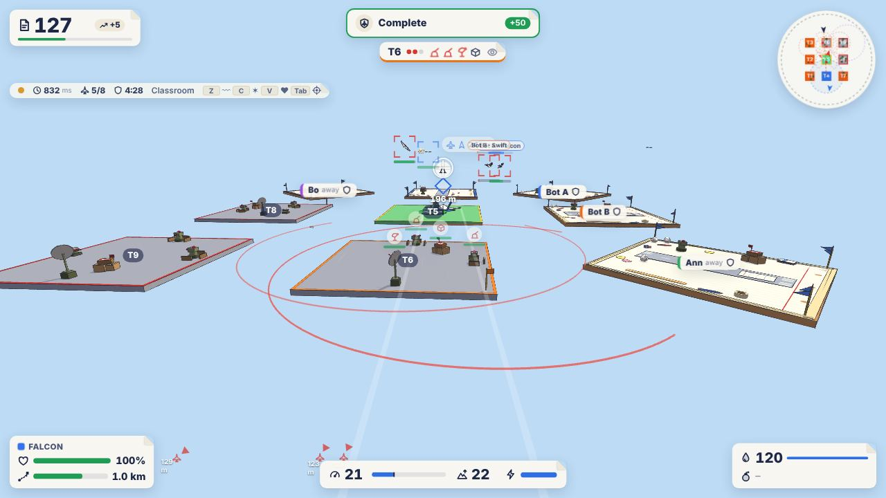

### What is in it

- **A server** (`server/`): Node + Colyseus 0.18 over WebSockets. A classroom session holds up to
  eight players in memory. `ServerWorld` runs each player's `GameState`, `Base`, `ResourceManager`
  and `MissionDirector` (single-player's own classes) and shares the defense network, the AI
  traffic and the ordnance between everyone. Clients send controls and commands only; the server
  decides every position, hit, kill, balance, building, objective and reward.
- **Shared types** (`src/net/`): the protocol (input frames, commands, private state, events,
  validation), the synchronised schema (quantized), the fixed-step flight both sides run,
  prediction, interpolation and the shared classroom layout.
- **Sessions and territories**: a menu to start, list and join classrooms; a map to claim one of
  eight desks (the centre stays the AI's). Claiming swaps the territory's AI defenses for the
  player's base, dressed as a desk with a runway; leaving brings the AI back.
- **Flight in sync**: 60 Hz input frames flown by the server through the same `FlightModel`;
  the pilot's plane is predicted and reconciled, everyone else's interpolated 100 ms in the past.
  Others' planes launch, fly, land and crash in front of you.
- **Combat between players**: server-validated, lag-compensated rounds; damage, destruction, kills
  and assists, a kill feed, bounties that can't be farmed, respawning by folding a new plane, and
  no spawn camping.
- **Raids on player bases**: raid cards against bases the rules allow (not new players, not offline
  ones, not a base just raided, not the same base again soon), a reward paid by the game, a capped
  loss of the defender's vulnerable paper (never their reserve), building damage, warnings and an
  interception card for the defender, their guns joining in, and reports for both sides.
- **Missions together**: each player's own board, plus rival cards (raid, scout, shoot down,
  intercept); missions never target other players' homes, and their AI aircraft fly under their
  owner's name.
- **Recognising each other**: names, colours, name tags with health, owner tags on desks, a
  scoreboard (Tab), emotes in flight (Z wing waggle, C confetti, V heart), session news, and the
  connection chip (status, ping, players, protection). No text chat.
- **Connections**: automatic reconnection with a 60 s grace period (territory and plane kept),
  back into the session after a browser refresh, the ninth player turned away, leaving mid-flight
  counted as going down.
- **Bots and a load test**: `npm run bots` fills a session with headless players (they dogfight,
  or with `--raid` raid bases) for testing alone; `npm run loadtest` measures 2, 4 and 8 players
  and a poor network.

| | | |
|---|---|---|
| 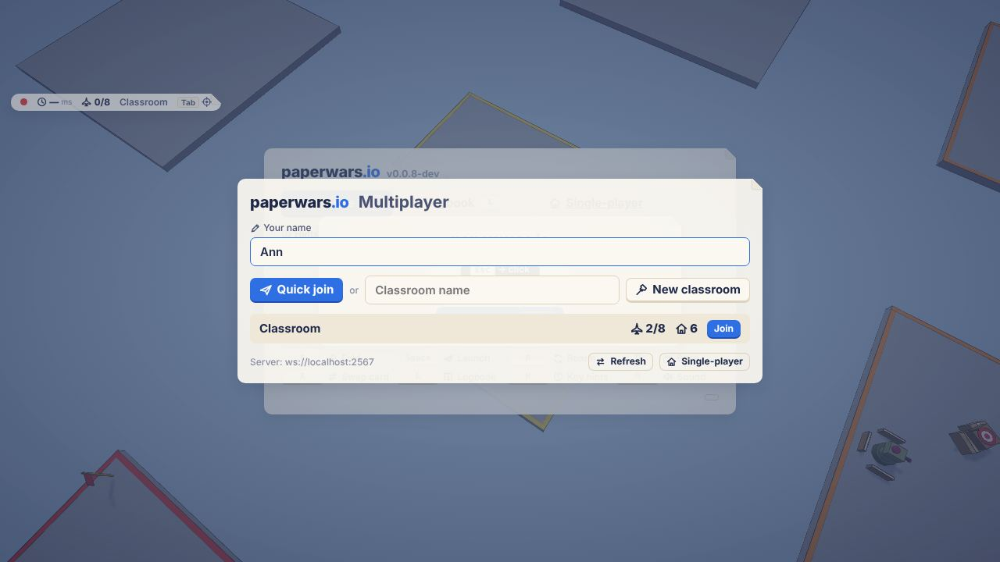 | 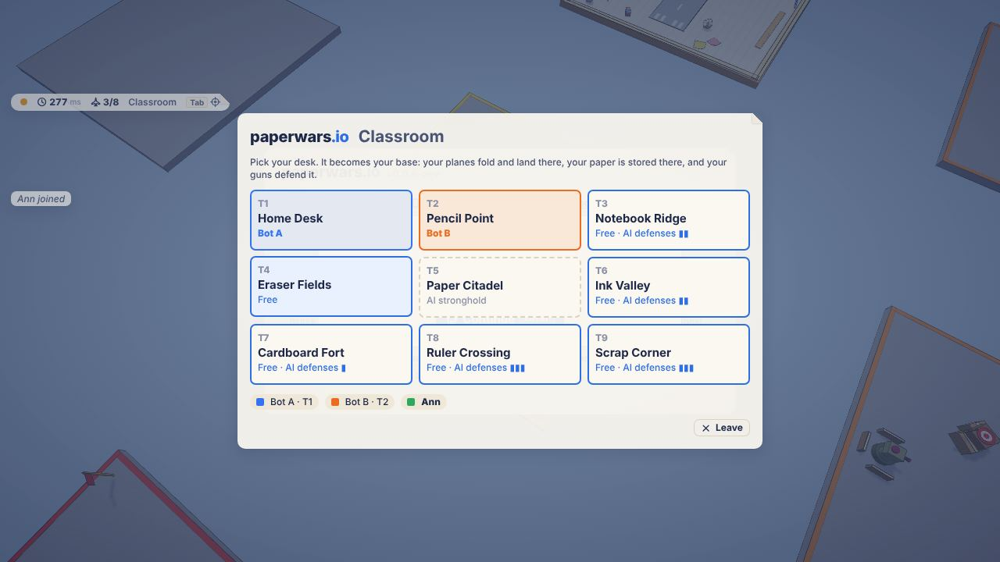 | 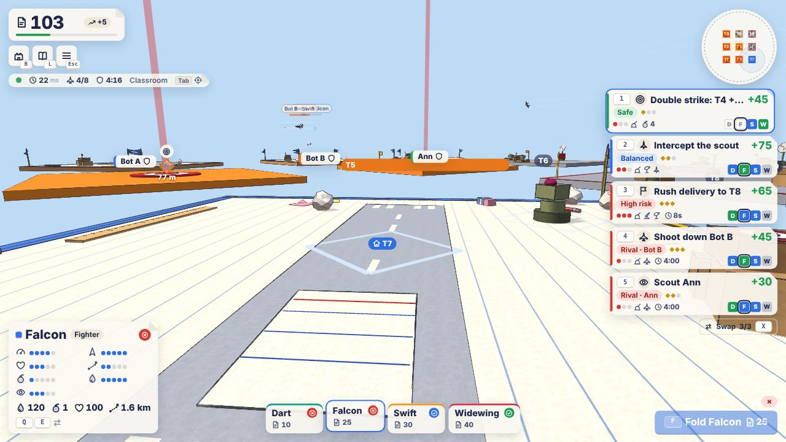 |
| 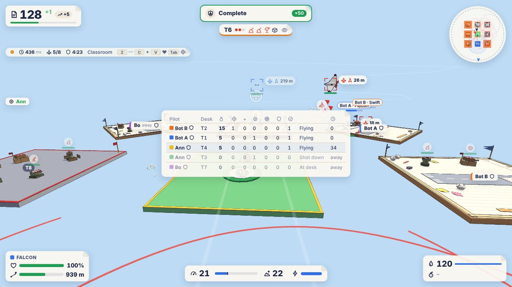 | 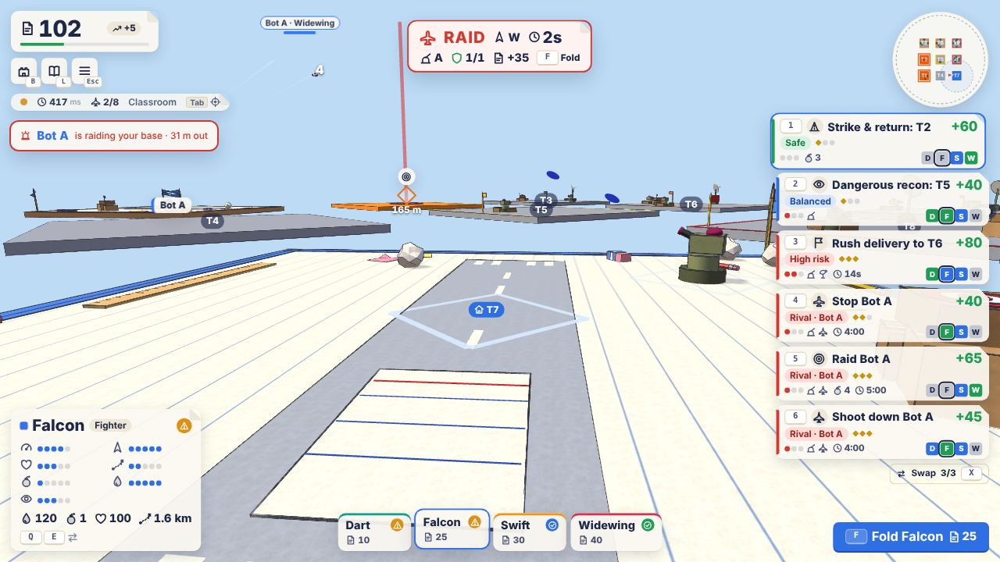 | 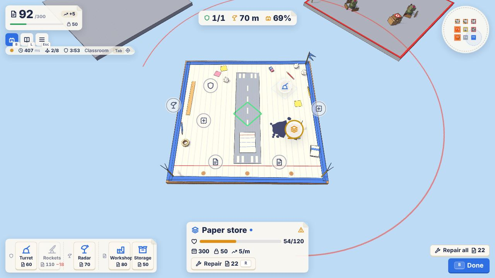 |

### Playing it

```bash
npm run server     # ws://localhost:2567
```

```bash
npm run dev        # then open http://localhost:5173/?mp in two windows
```

```bash
npm run bots -- --count 3    # alone: three bots join and dogfight
```

Another computer on the network: `http://<host>:5173/?mp&server=ws://<host>:2567` (start Vite
with `--host`). `PROTECTION=20 npm run server` lets new bases be raided after 20 s instead of five
minutes, and `npm run bots -- --count 1 --raid 1` sends a bot to raid them.

### Measurements

`npm run loadtest` (bots with the browser's prediction; server and bots in one process, no GPU):

| Players | Network | Server step avg (ms of 16.7) | Down / up per player (KB/s) | Prediction corrections |
|---|---|---|---|---|
| 2 | local | 0.38 | 9.8 / 1.2 | 0 of 1,186 |
| 4 | local | 0.35 | 10.3 / 1.2 | 0 of 2,382 |
| 8 | local | 0.43 | 13.3 / 1.2 | 0 of 4,758 |
| 8 | 120 ± 40 ms, a stall every 5 s | 0.45 | 13.8 / 1.2 | 4 of 4,772 (2 cm on average) |

A connection cut mid-fight and resumed kept its seat in every run. The browser client was driven
in headless Chromium (software rendering, about 1 fps); frame rate, input feel and combat
readability on real hardware still need playtesting.

### Known limitations

- Sessions live in memory on one server process: no accounts, persistence or campaign yet
  (v0.0.11). A server restart ends every session.
- Eight claimable desks in the 3 × 3 classroom; more territory slots come with the world expansion.
- Homes are dressed without the Home Desk landmark and tall props (the server doesn't know their
  collision shapes); remote planes don't show bomb racks or the fold animation.
- World events, medals, records, the logbook and the local save are single-player only; escorting
  another player isn't a mission yet.
- `npm audit` flags advisories in `@colyseus/auth`'s dependencies, unused by the game.

### Decisions for the developer

1. **The rules in `PVP`** (`src/config.ts`): protection and shield times, raid rewards and the
   repeat rule, bounties, aggression and score weights are first guesses.
2. **Free-for-all** for now (no teams or alliances).
3. **Bases can only be damaged on a raid**, never by passers-by.
4. **The centre stays the AI's** stronghold.
5. **Hosting**: any Node host with WebSockets (`PORT=… npm run server`).

## v0.0.8 in progress: the visual vertical slice

v0.0.8 gives the game its permanent look and a world to match (plan in the
[roadmap](docs/GDD.md#version-008-world-expansion-visual-identity-and-player-experience)). It is
built in phases with developer checkpoints; this is **phase 1, the visual vertical slice**, which
the plan asks to be approved before the look is rolled out to the rest of the world.

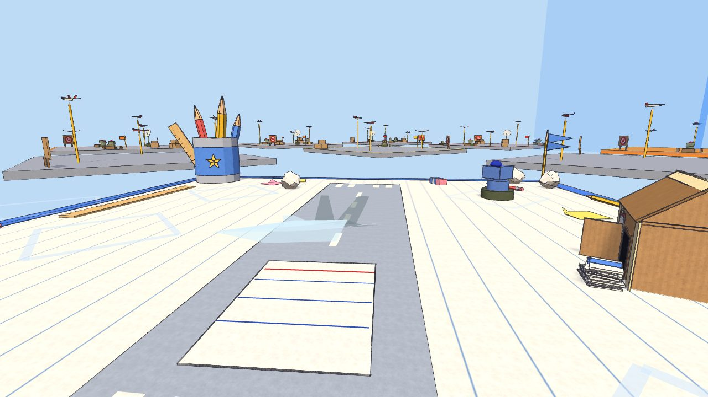

### What is in it

- **Pencil-outline renderer** (`src/render/outline/`): graphite strokes along silhouettes, folds
  and paper edges, built from each mesh's edges and widened on screen by a shader, with per-object
  strength (aircraft and rockets boldest, buildings and targets firm, props lighter, trims
  faintest), distance thinning and fading, and stable hand-drawn irregularity (uneven width,
  wobble, runs past the corners, grain). Applied to every aircraft (folding and crumpling
  included), defense, target, bullseye, rocket and platform in the game.
- **Paper shading and light** (`src/render/shading/`, `lighting.ts`): a soft cel ramp, sky and
  ground ambient, light coloured shadows, and paper grain on every lit surface.
- **Material library** (`src/render/style.ts`, `materials/`): paper (white, notebook, graph,
  sticky, coloured), cardboard, tape, ink, pencil, rubber, wood and plastic, with procedural
  textures painted at start-up (no image files).
- **Home Desk** (T1): a wooden desk with a sheet of notebook paper taped down in the player's blue,
  a margin and binder holes, a taped runway and an index-card launch pad, a **pencil-cup landmark**
  (with simple colliders, below the AI's cruising height), a **custom cardboard paper store**
  (gable flap roof, door flap, reams by the door; it still darkens, collapses and is repaired as
  before), and original stationery props: pencils, a ruler, an eraser, sticky notes, tape, paper
  balls, paper stacks, folded-paper flags, plus a book stack and a globe as placeholders for
  licensed models. Nothing sits on the runway, the take-off path, the slots or the store (tests
  check it).
- **Licensed asset pipeline** (`src/assets/`): drop Synty (or other licensed) `.glb` files into the
  git-ignored `assets/licensed/` and they replace their placeholders, adapted to the look (paper
  shading, matte, outlines, fitted to size). Original Blender models go in `assets/models/`. No
  licensed files are in the repository; see [assets/licensed/README.md](assets/licensed/README.md).
- **Graphics settings** in the pause menu: **Graphics** Low / Med / High (outline quality,
  shadows, decoration, resolution), **Outlines** Off / Low / Med / High and **Lines** Faint /
  Normal / Bold. Stored per computer, apart from the save.
- **`?perf`** in the address shows fps, frame time and spikes, draw calls, triangles and strokes;
  `paperwars.perf()` and `paperwars.assets.report()` in the console.

### Reviewing it

```bash
npm run dev        # then open http://localhost:5173/?perf
```

- The opening view is the desk camera over Home Desk; **B** shows the base from above.
- Fly to see outlines in motion, banking and combat; **Esc** for the graphics settings.
- Screenshots of every view are in [docs/checkpoints/0.0.8-visual-slice](docs/checkpoints/0.0.8-visual-slice).

| | | |
|---|---|---|
| 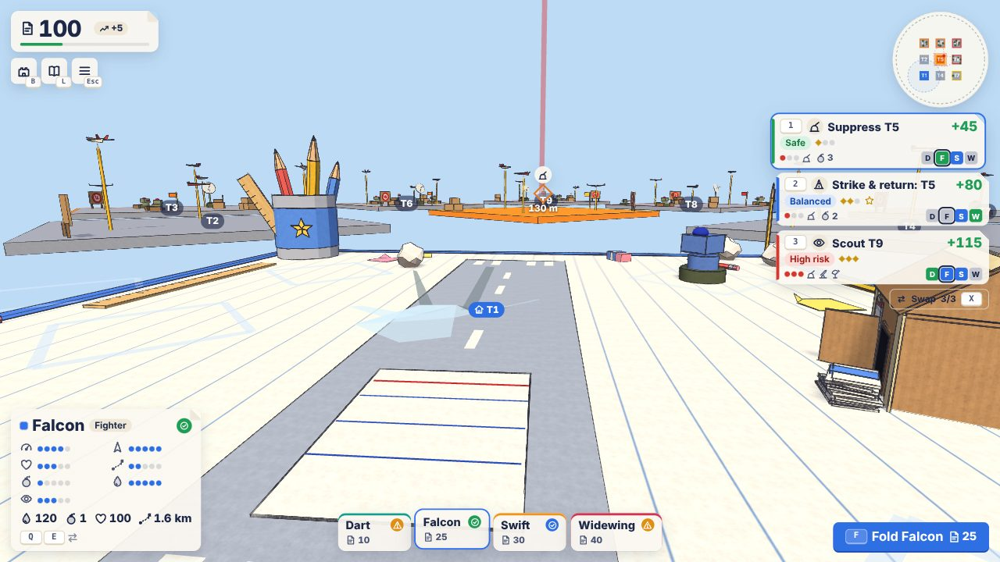 | 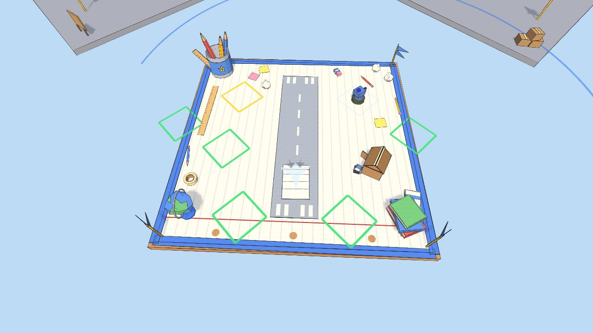 | 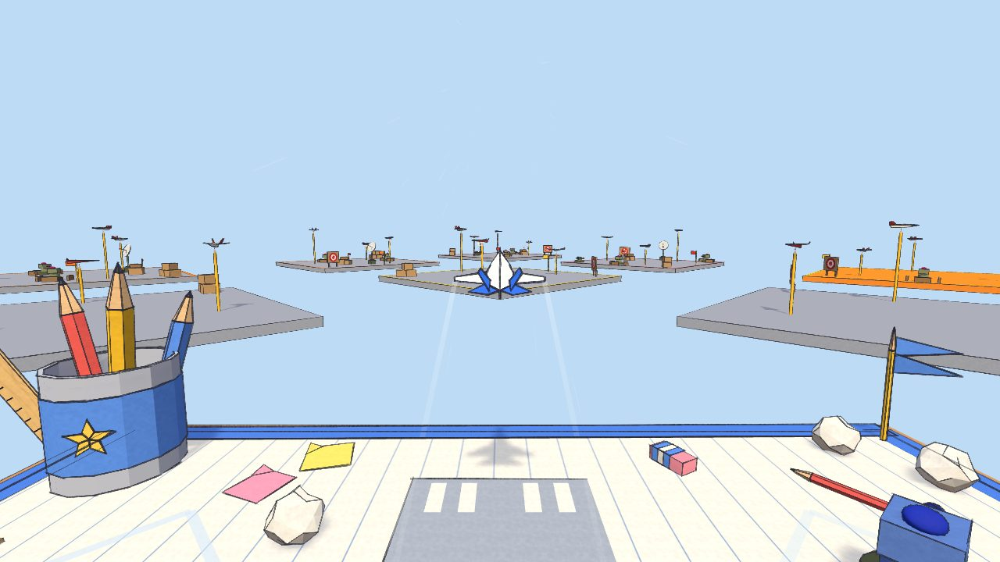 |
| 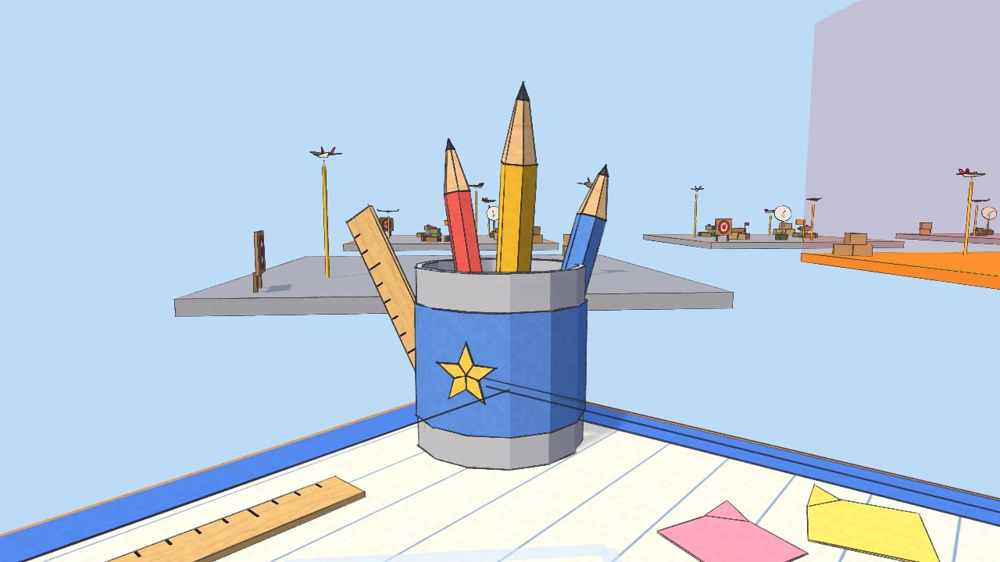 | 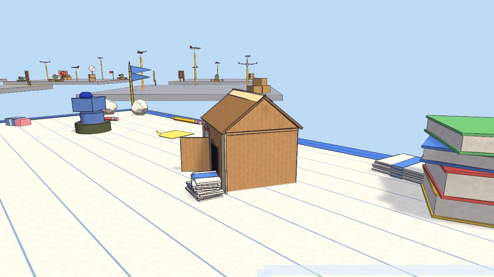 | 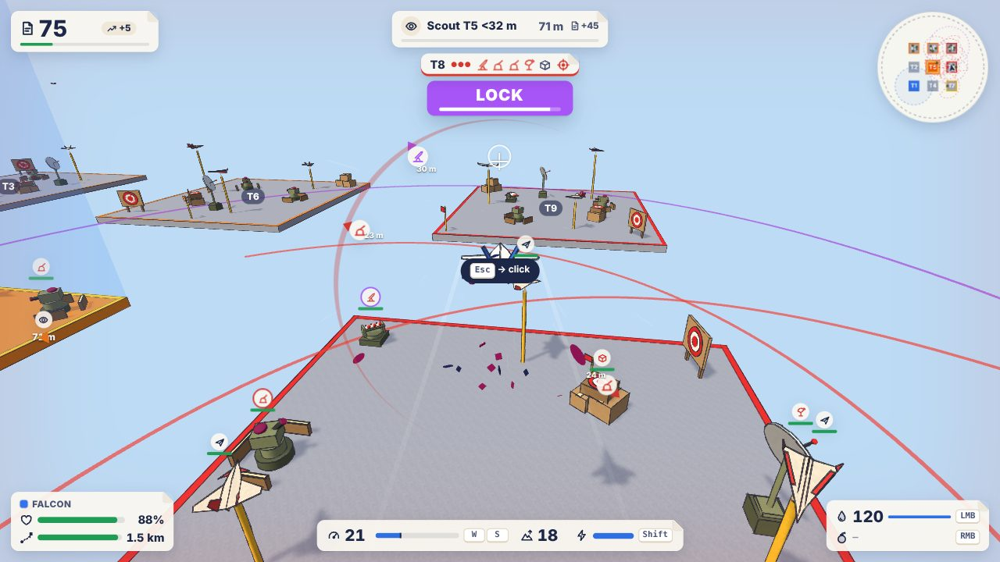 |
| 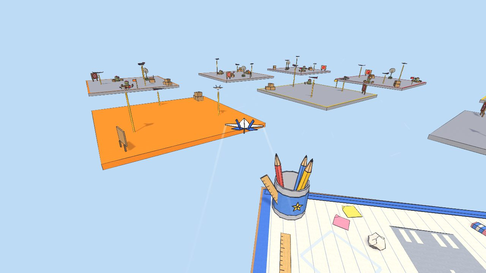 | 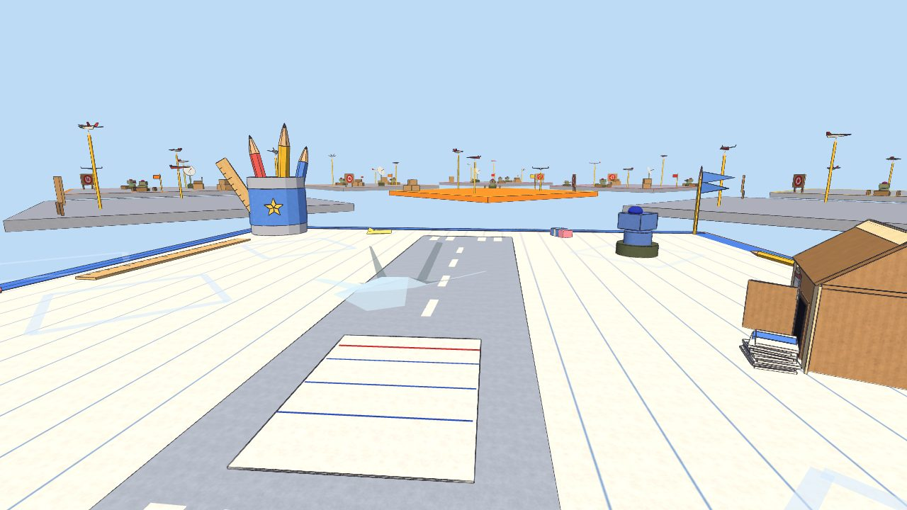 | 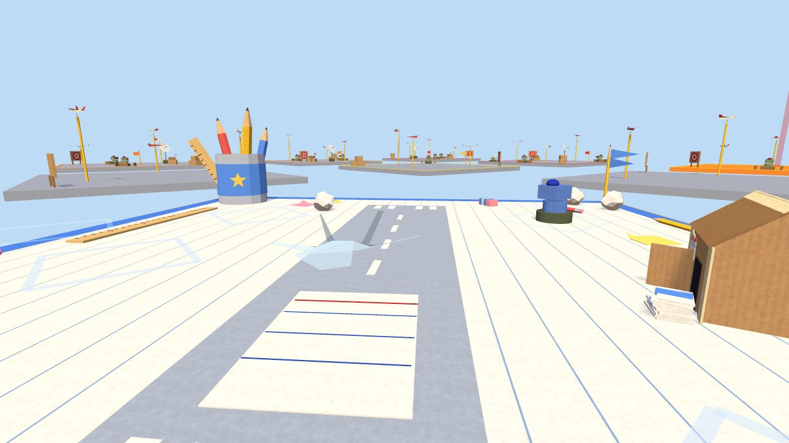 |

### Measurements

Production builds, before (v0.0.7) and after, at 1280×720 in headless Chromium. **This machine has
no GPU**: rendering is SwiftShader (software), so frame times measure the CPU rasterizer, not a
graphics card. Draw calls, load stages and memory carry over; real frame times still need
measuring on hardware with `?perf` (Chrome, Edge, Firefox).

| | v0.0.7 | Slice (High) | Slice (Low) |
|---|---|---|---|
| Draw calls, desk view | ~1,010 | ~1,215 | ~690 |
| Draw calls, in flight | ~795 | ~910 | |
| Game ready (ms from page start) | ~300 | ~500 | |
| First frames shown (ms) | ~600 | ~1,070 | |
| JS heap (MB) | ~18 | ~30–34 | |
| Bundle (min / gzip, kB) | 1,494 / 416 | 1,618 / 458 | |
| Frame time, desk, software rendering (ms) | ~225 | ~490 | |

Most of the extra draw calls are strokes for the moving parts of installations; static
decoration and walls are merged into a handful of meshes. The bundle grows mostly by the engine's
glTF and texture loaders, for licensed models. The slower first frames are new shader variants
(textured paper, strokes) compiling, much slower in software than on a GPU.

### Known limitations

- Only Home Desk is themed; the other territories, enemy installations and T1's other buildings
  keep their v0.0.7 models (now outlined and shaded). Classroom backdrop, themes, names and
  landmarks for the rest are phases 2 and 3.
- No GPU measurements yet (see above). Antialiasing can't be changed in-game yet.
- Effects and most mission markers aren't outlined yet (phase 5).
- No licensed models were supplied; the book stack and globe are placeholders. The import path
  was checked end to end with an original test `.glb` (not committed).

### Decisions for the developer

1. **Approve or adjust the art direction**: line weight and colour (`OUTLINE` in
   `src/render/style.ts`), the cel ramp and shadow strength (`SHADING`, `LIGHTING`), the cream
   notebook paper and blue tape border for player ownership.
2. **Which Synty packs** (if any) to buy for the classroom environment, and which props they
   should fill: the slots are in `src/assets/manifest.ts`.
3. **Default preset:** High is the default (closest to v0.0.7's shadows and resolution); Medium
   would be safer on integrated graphics.

## Run it

Requires Node 20+.

```bash
npm install
```

```bash
npm run dev        # http://localhost:5173
```

Other scripts:

```bash
npm test           # unit tests for the rules, plus the multiplayer server, prediction and room tests
```

```bash
npm run build      # typecheck + production build into dist/
```

```bash
npm run preview    # serve the production build
```

Multiplayer (see [docs/MULTIPLAYER.md](docs/MULTIPLAYER.md)):

```bash
npm run server     # the multiplayer server, ws://localhost:2567; then open the game with ?mp
```

```bash
npm run bots -- --count 3      # headless players for a session
```

```bash
npm run loadtest   # 2, 4, 8 bots and a poor network: server step time, bandwidth, prediction
```

The game needs a desktop browser with WebGL 2.

## What's new in v0.0.7

### T1 is a base

Press **B** at home (at the desk, or landed and stopped) for **base management**: the camera rises
above T1, every construction slot gets a marker, and the HUD switches to the build tray (bottom
left), the slot inspector (bottom centre) and Repair all / Done (bottom right). It is the normal 3D
world, only from higher up; flying stays third-person.

**Fixed slots** (`BASE.slots` in `src/config.ts`): two **defense** slots at the front of the
platform, one **radar** slot, two **economy** slots at the back and two **utility** slots on the
flanks that take anything but a radar. Weapons face outward from the middle of T1, so where a
turret stands decides what it covers. Slots are limited on purpose: a utility slot holds a turret
*or* a workshop, never both. The **paper store** always stands (it can be wrecked and repaired).

| Building | Cost | Upgrades | Slots | Level 1 → 3 |
|---|---|---|---|---|
| Ink turret | 60 | 45, 70 | Defense, utility | Range 45 → 55 m, 4 → 6 damage, 2.9 → 3.6 rounds/s, 24 → 32-round magazine, then a 3 → 2.2 s reload |
| Paper rocket launcher | 110 | 80, 120 | Defense, utility | Range 75 → 88 m, 28 → 36 damage, reload 7 → 5 s; deals with **bombers first** |
| Radar station | 70 | 50, 80 | Radar (one per base) | Early warning at 140 → 260 m; alerts T1's weapons (instant fix) |
| Paper workshop | 80 | 60, 90 | Economy, utility | +2 → +9 paper per minute (5 → 7 → 10 → 14 with one) |
| Storage box | 50 | 50, 80 | Economy, utility | +200 → +900 capacity (300 → 500 → 800 → 1,200), +25 → +80 protected paper |

- **Build:** pick a building in the tray (it jumps to a free slot that takes it), see the
  see-through preview (green fits and is affordable, red not), check the cost and effect in the
  inspector, press **Build** (Enter). It folds up out of the platform in under a second.
- **Upgrade** (U) keeps the share of health it had; up to level 3. A wreck must be repaired first.
- **Repair** (R): half the building's value per share of health missing (a turret at half health
  costs 15); bringing a wreck back costs 70% of its value, still less than building anew.
  **Repair all** fixes everything, the store too, if the paper covers it.
- **Remove** (X, twice): the slot is free again and half of what went in comes back, by condition.
- Unaffordable buildings show the paper still missing (`−25`), everywhere.
- Keys in base management: **1–7** pick slots (0 the store), **Enter** build, **U** upgrade,
  **R** repair, **X** remove, **B** or **Esc** done, **Space** launch / take off.

A new game starts with one turret in a defense slot. A v0.0.6 save keeps its two T1 turrets as
built turrets in both defense slots.

### Player-built defenses

T1's turrets and launchers are the 0.0.4 defense systems, owned by the player: they detect,
turn, lead and fire at **hostile aircraft only** (never the player's plane or a friendly bomber),
take damage and are wrecked. Player turrets fire a magazine, then pause to reload; launchers lock
on and switch to a bomber the moment one is in sight, turrets take the nearest. Each building's
inspector shows its health, range, damage, rate, magazine and **aircraft shot down**; kills by
T1's guns are announced (they still pay no defense reward without the player's help). **Damage
stays between sorties** until it is repaired.

### Paper: production, capacity, protection

- **Production:** 5 paper a minute, plus the workshops (a damaged one produces less, a wreck
  nothing), **×3 below 50 paper** so a broke player is never stuck, halved while the paper store is
  wrecked. It stops when the store is full.
- **Capacity:** T1 holds 300 paper, more with storage boxes. Earnings beyond it are **lost** (the
  alert says how much, and the report counts it), so a full store is a reason to spend or build
  storage. A save with more than the capacity keeps it, but nothing more comes in until it drops.
- **Protected and vulnerable paper:** 50 paper (a fighter's worth) is always safe, more with
  storage boxes (damage exposes it). Paper above that is **vulnerable**: a raider's bomb on target
  destroys **10% of it (at most 40)**, or **20% (at most 80)** if it hits the paper store itself.

### Raids on the base

- **Targets:** each raid picks a standing T1 structure when it sets out: the store (more likely the
  more vulnerable paper it holds), storage boxes, workshops, the radar, launchers, turrets. The
  blast damages whatever is near where it lands.
- **Detection:** a raid is only announced once T1 sees it: within 70 m without a radar, the radar's
  range with one (140 / 190 / 260 m by level). A wrecked radar is offline. Undetected raiders don't
  show on the mini-map either.
- **Early warning:** the raid alert (top centre) shows the bomber, the direction it comes from
  (N, NE…), the time to target, what it is after, how many weapons are ready, the reward, and what
  to do now (F fold / Space launch). The emergency card goes on the board when it is detected.
- **Defense report** after every raid: raiders shot down (by T1's guns and by you), paper lost or
  saved, structures hit, the repair bill, the defenses' share of the damage, and one line on what
  decided it. The base view and the logbook keep the numbers.
- **Pacing:** the mission director slows the raid clock while T1 is battered, the player is
  struggling or busy on a mission, or there is little paper to take, and speeds it a little for a
  skilled player. After a raid that cost paper or wrecked something, the next waits at least 150 s.
- **Active and passive defense:** launch a fighter, trust the guns, or both. Both works best.

### The new HUD

Everything is in fixed zones: paper top left; the objective, threats, the raid alert, alerts and
tips top centre; the mini-map (with T1's radar ring and sweep) top right; the plane's condition,
instruments and weapons along the bottom; the centre left clear.

- **Icons and numbers instead of words:** `[speed] 142`, `[ink] 34`, `[bomb] ●●○`, `[paper] 340/500`,
  `+7/m`. Every icon has a tooltip. Cards, reports, markers and the menu were cut down the same way.
- **Alerts:** an icon, one to three words and at most one number, coloured by severity; at most
  three at once, repeats count up (`×2`).
- **First-time tips** replace the rules on the pause screen: each shows once per save, when it
  matters (first flight, each kind of objective, first raid, first landing approach, storage full…).
- **Key hints** show for the first three sorties, then while **H** is held (or always / never in
  the menu). The menu also sets the **HUD size** (S / M / L).
- **Sortie report:** headline and medal, four big numbers, bonuses and records as chips, and the
  full breakdown behind *Details*.
- **Logbook:** a new **Base** tab (buildings with their records; raids survived, bombers downed by
  defenses, paper lost, spent on construction and repairs, made by workshops, repairs). Career
  numbers moved here from the HUD.
- Under the hood: design tokens and shared components in `src/ui/hud.css`, the HUD split into
  per-zone modules, all short labels in `src/ui/strings.ts`, the version read from `package.json`.

### Saving

Save format version 2 adds the base (buildings, levels, health, records, statistics) and the new
settings (key hints, HUD size, tips seen). Version 1 saves are migrated; a damaged base entry is
dropped or clamped, never trusted.

## Since v0.0.6: dynamic missions, progression and balance

### The mission director

A central system (`src/director/MissionDirector.ts`) now deals the mission cards from explicit
rules, templates and weighted choice. No generative AI: every card is a mission type (the
template) whose parameters (target, threat level, objectives, enemy aircraft, time limit,
reward) are filled in from the world.

- **Three cards: safe, balanced, high risk.** The safe card is always easy (unprotected or
  lightly defended ground, rookie pilots at most), for everyone. The balanced and high-risk
  cards' tiers grow with the player's skill (below). Pick any of them: nothing is locked.
- **Four tiers.** Easy ×1, Medium ×1.5, Hard ×2 and **Very hard ×2.5**: hard content with one or
  two escalations on top (a second fighter, a bomber escort, an extra target, a mandatory return
  flight, a stricter clock). Difficulty grows by new combinations of threats, never by more
  enemy health or damage.
- **Only the flown card is replaced.** After a sortie (success or failure) its card is dealt
  afresh; the other two stay unless they became impossible.
- **Swap a card you dislike (X).** Three swaps in hand, one back after every sortie.
- **Variety memory.** Each recent mission in the same category (bombing, recon, flight,
  dogfighting, interception, escort, assault) makes that category less likely; the cards on the
  board are always of different categories; the mission you just flew is never dealt again as it
  was.
- **Eligibility.** A card is only dealt if it can be done: its enemy aircraft can go up within
  the sky's limit of four (raids and events count), no raid interception while a raid is already
  on, a plane you can afford (or the free emergency Dart) can fly it with enough bombs, and every
  target it names is still standing. Cards whose targets are destroyed are replaced.
- **Mission history.** Every card offered, accepted, completed, failed, swapped, invalidated or
  expired is logged (developer panel, `paperwars.director.history` in the console, and the save).

### Performance and adaptive difficulty

`src/director/Performance.ts` rates the last ten missions, the newest counting most: success
rate, planes kept, damage avoided, speed against par, gun accuracy, safe landings, and hard
missions done. The rating moves a **skill** (0–1) that sets the balanced and risky cards' tiers:
it waits for three missions, then follows the rating by at most 0.07 a mission, so one good
sortie never makes the next much harder. The logbook shows the tier the director thinks suits you.

**Recovery missions.** After losing two planes in three sorties, failing three of four, or with
nothing better than a Dart affordable, the safe card becomes a recovery mission: reconnaissance
of an undefended territory, an easy ring course, a delivery, or one weak practice target, with no
enemy aircraft, paying **at least 30** (a Falcon and change). The balanced card is capped at medium
meanwhile.

### Economy

Paper is still the only resource.

- **Reward = B × D × M**, rounded to 5. B is the type's base plus distance, threat and air
  bonuses; D the tier's multiplier; M the modifiers' (tight clock ×1.1, a territory on alert
  ×1.2, a high-value target ×1.5). Cards show the breakdown on hover.
- **Rebalanced to plane costs.** Rewards came down (v0.0.5 hard cards paid up to 305) to the
  plan's bands: easy Dart work 25–40, medium ~50–100, hard ~75–150, very hard ~140–230.
- **Free emergency Dart.** With no plane affordable and none in the hangar, F folds a scrap Dart:
  half the ink, no bomb, shorter range, gone after the sortie. The balance never goes negative.
- **Home production** (v0.0.6: +1 every 3 s up to 120; since v0.0.7 set by the base, see above). It
  only runs while the game does.
- **No failure fines.** A failed mission costs the plane (if lost) and nothing else; abandoning
  pays nothing, so launching and abandoning earns nothing (the economy simulation checks it).
- **Paper log.** Every change with what it was for ("Folded Falcon −25", "Mission completed +80",
  home production gathered into one line), the last four under your balance, the full log in the
  logbook, plus totals and paper in/out per aircraft and per mission type.

| Profile (economy simulation, 40 sorties) | Paper | Paper per success | Planes lost |
|---|---|---|---|
| New player (picks safe/balanced) | 100 → ~1,100–2,000 | ~60 | 5–9 |
| Struggling player (12 paper, losing planes) | 12 → ~380–720, never stuck | ~55 | 17–22 |
| Wealthy veteran (picks risky) | 600 → ~5,100–6,200 | ~160 | 4–5 |

### World events and territory states

`src/director/WorldEvents.ts`: at most one at a time, 100–170 s apart, none before your first
sortie. Each puts an optional **fourth card** on the board while it lasts; ignoring it costs
nothing (a raid's capped toll aside).

| Event | What happens | Card | Off the card |
|---|---|---|---|
| Raid on T1 | An enemy Widewing heads for the paper store (v0.0.5 raids, now waiting their turn) | **Emergency: defend T1**, paid through the mission | +60 if you helped, as before |
| High-value shipment | A paper shipment sits on a territory's crates for ~3 minutes | Destroy it (×1.5) | +45 bounty on any sortie |
| Convoy | An enemy supply Widewing (sometimes escorted) crosses the map | Intercept it before it leaves | +50 bounty on any sortie |
| Supply run | A friendly Widewing brings paper in past unprotected ground; enemy fighters come after it | Escort it | +50 supplies if it delivers |

**Territory states.** *On alert* after you destroy something there: its wrecks stay down, its
defenders get a fix the moment they see you, easy cards keep away, and missions there pay ×1.2.
*Defenses down* once every weapon is destroyed: wrecks stay for four minutes and it counts as
unprotected. *Under attack*: T1 while a raid is coming. States show on the territory labels and
reset when they run out.

### Operations

Short chains against one territory, flown over several sorties with any planes:

| Template | Stages |
|---|---|
| Strike (guarded or fortified) | Reconnoitre → destroy its radar → bomb its supply depot and land on T1 |
| Light (lightly defended) | Scout → silence its guns → bomb it and land on T1 |
| Air | Catch the scout over it → win the dogfight → escort a bomber there |

The operation card takes the balanced slot; completing a stage opens the next, a failed stage can
be retried, and its territory stays on alert (its wrecks stay down) until the operation ends.
Each stage has an optional objective (bring the plane home, take under 25% damage, finish within
par) worth 10–25. Finishing every stage pays a **bonus** (a quarter of the stages' rewards, at least
20). **Abandon** (two clicks) keeps what was earned and forfeits only the bonus.

### Replayability

- **Medals.** Bronze for the objective; silver with at most 40% damage and efficient play (no more
  than one spare bomb, 18%+ ink accuracy in a gunfight, or within 1.5× par); gold within par
  time with the plane brought home. The report says what the next medal needs.
- **Personal bests:** fastest bombing run, most accurate bombing mission, longest successful
  flight, most aircraft downed in a sortie, most missions in a row without losing a plane.
- **Streaks:** +5% from three successes in a row, +10% from five. A failure resets it, nothing more.
- **Aircraft mastery:** flights, missions by category, losses, ink and bomb accuracy, kills per
  design (logbook and garage). Statistics only: nothing unlocks.
- **14 achievements**, saved locally.
- **Session summary** in the menu (Esc), and on your next visit a *Welcome back* card with the
  last one.

### Saving

`src/systems/SaveGame.ts`: IndexedDB, falling back to local storage, then memory. Saved: paper,
chosen plane, the hangar, the director (cards as recipes, history, swaps, recent missions,
performance, the operation), progress, the paper log and settings. A plane in the air when the
page closes comes back to T1 as a recovered plane. Every field is validated on load and repaired
or dropped (never crashing), the format is versioned with a migration chain (a save from a newer
version is kept aside, never overwritten), and **Reset progress** (menu, two clicks) deletes it.
World events are not saved: they reset on reload.

### Developer tools

Press **`** (or open with `?dev`) for the director panel: the performance rating and its
indicators; each card's slot, tier, B × D × M and why it was chosen; every candidate type for a slot
with its weight or the reason it was left out; the tier and modifier multipliers; events, cooldown
and territory states (with buttons to start any event); **force a mission** (type, tier, target,
slot); **simulated players** (new, struggling, average, successful, wealthy veteran) to preview
their deals or apply to the game; the **economy simulation** (30 sorties per profile through the
real director); the history with type frequencies; and paper efficiency per aircraft.

## Since v0.0.5: enemy aircraft and interception

### Enemy aircraft

AI pilots fly paper planes around the world: the **same designs, flight model, health and ink
guns** as yours. A pilot only decides where to point (an aim direction, exactly like the mouse
sets one), how fast to go, when to boost, shoot and drop; the flight model you fly does the rest
(`src/aircraft/FlightModel.ts`, extracted from the player's controller for this).

| Role | Aircraft | Behaviour | Typical difficulty |
|---|---|---|---|
| Scout | Dart | Flies its route, circling what it scouts. Once it spots you it runs for the edge of the map, boosting and jinking. Never shoots. | Easy |
| Fighter | Falcon | Turns on aircraft it notices, works its way behind them, holds gun distance and fires in bursts when lined up. Breaks off when you get too far, it gets too hurt or runs out of ink, then comes back. | Medium |
| Bomber | Widewing | Flies to its target, lines up and makes a steady, predictable run at bombing height, then heads home. Jinks when attacked on the way in, takes potshots with its nose gun, turns back when badly hurt. | Medium |

Each pilot is a small **finite-state machine**: patrol → noticed something (a reaction delay) →
attack, run or carry on (by role) → reposition after overshooting → evade → disengage → leave.
Routes are waypoints at safe heights; a look-ahead along the flight path climbs away from platforms,
and a predictive separation check keeps aircraft from flying into each other.

**Skill changes behaviour, not health.**

| | Rookie (easy) | Regular (medium) | Veteran (hard) |
|---|---|---|---|
| Reaction time | 1 s | 0.6 s | 0.3 s |
| Base scatter (either way) | 6.5° | 4.5° | 3.5° |
| Trigger discipline | 0.35 s bursts, 1.5 s pauses | 0.45 s / 1 s | 0.6 s / 0.8 s |
| Leads its shots by / anticipates turns | 50% | 80% | 95% |
| Speed it pushes to (cruise → top) | 45% | 75% | 100%, with boost |
| Evasive turns with someone on its tail | never | sometimes | often |
| Breaks off when hurt | never | below 25% | below 35%, boosting and weaving away |
| Works behind you before attacking | never | half the time | always |
| Follows you down to | 10 m | 7 m | 4.5 m |
| A bomber's release error | ±10 m | ±6 m | ±2.5 m |

**No perfect aim.** A pilot's rounds scatter by its skill, and more the further you are, the more
your speeds differ, the harder you turn, and the less time it has been tracking you; its idea of
your velocity also lags behind your real one, so a change of course throws its lead off.
Measured against a Falcon circling at cruise: a rookie does about 0.7 damage a second, a regular
about 4, a veteran about 11, and flying unpredictably cuts that by a third or much more. Flying
straight with a veteran on your tail is the fastest way to lose a plane.

### Dogfighting

- **Your ink hits aircraft** through the same swept projectile collisions as everything else,
  against each plane's movement every step.
- **Aim assistance:** a round counts as a hit if it passes within a small cone (1.6°) of an
  aircraft, at most 1 m beyond its size. Close in you still have to hit it. Nothing aims for you.
- **Markers:** corner brackets, name, distance and what it is doing ("Attacking you!", "Running!",
  "Bombing run!", "Breaking off"). Far ones fade; crowded ones shrink to brackets. A health bar
  shows while you aim at one, just hit it, or it matters to the mission. Off screen, a subtle chevron
  at the edge points to it.
- **Lead sight:** a small red circle where to shoot at the enemy nearest your nose.
- **Kill confirmation:** the plane crumples into a tumbling paper ball, "SHOT DOWN!", a banner and
  a chime; mission progress and career stats update.
- **Escape:** fighters chase at most 140 m from where they started, and no further than 110 m from
  what they guard; outrun or outturn them and they break off. They never follow you over home.

### Raids on T1 and interception

Every three to five minutes (once you have flown a sortie), a Widewing sets out from beyond a far
enemy territory for **T1** (since v0.0.7 for one of its buildings, announced once detected, see
above). In v0.0.5 the alert came straight away, with an ETA:

> **INCOMING BOMBER** · Enemy Widewing approaching T1 from T9 · ETA 31 s
> Target: home territory · paper store. Objective: intercept before bomb release. Defense reward +60 paper.

It circles over its territory to form up, crosses the map and makes a straight run at the store,
about half a minute after the alert, enough to fold a fighter at the desk and take off. Shoot it
down (or make it turn back) and you earn **+60 paper**, but only if you took part: T1's own guns
help, but they don't earn you anything by themselves. A hit costs paper above the protected
reserve (since v0.0.7 a share of the vulnerable paper). After the first two raids, some come with a
fighter escort.

**T1's defenses** were two predefined ink turrets in v0.0.5; since v0.0.7 the player builds them.
They only shoot at hostile aircraft. Nothing hostile fires at you over home, or in the first six
seconds after take-off.

### Mission types in the air

| Type | Objective | Fails if | Recommended |
|---|---|---|---|
| Dogfight | Shoot down an enemy fighter patrolling a territory. It fights back. | | Falcon |
| Scout interception | Shoot down a Dart scouting two or three territories before it slips away | It escapes | Falcon (Dart, Swift good) |
| Bomber interception | Stop a raid on T1: shoot the bomber down before it releases. Hard raids are escorted. | It releases its bomb | Falcon (Swift good) |
| Bomber escort | Keep your own Widewing flying until its bomb hits a bullseye. Enemy fighters come for it. | Your bomber is shot down | Falcon (Swift good) |
| Airspace patrol | Spend 20/25/30 s over a territory and shoot down every intruder that turns up | An intruder escapes | Falcon |
| Combined attack | Hit a bullseye on defended ground while a fighter patrols overhead | | Swift |

Every deal of three cards now has one mission against the defenses and one in the air. Easy cards
only meet rookie pilots, over unprotected or lightly defended ground. Enemy aircraft add to the
reward by skill (+10/+18/+28 before the difficulty multiplier), and cards say who is up there:
"Air threat · No ground defenses · Air: 1 fighter + 1 bomber (veteran)".

### A world with traffic

Up to two **ambient patrols** (scouts, fighters, or a bomber crossing) fly over enemy country (T3,
T6, T8, T9) even when no mission needs them. They come and go out of sight, stay in their zone, and
fighters among them will go for you if you trespass. They **pay nothing** when shot down, so there
is nothing to farm. At most **four** AI aircraft fly at once; missions and raids come first and
patrols head home to make room. Aircraft only appear and disappear out of view, beyond the edge of
the map.

### Sound

Warning chirps when a fighter turns on you, an air-raid wail when a bomber sets out, a whoosh as
planes flash past, a tick of ink fire, a paper crunch when a plane goes down and a chime when you
got it. A low combat track swells while fighters are on you and fades when you get away (M mutes
everything).

### Sortie report

New rows: enemy aircraft destroyed, bombers intercepted, friendly objectives protected (raids beaten
off with your help, escorts seen home), and paper lost to raids, which the net change now includes.
Damage dealt and taken, shots fired and accuracy were already there. The career panel counts
aircraft shot down.

## Territory defenses (since v0.0.4)

T2–T9 have threat levels and the defenses to match (T1's own guns are described above).

**Threat levels.** Every territory except home has one, fixed in [`src/config.ts`](src/config.ts)
(`THREAT.map`). The danger grows towards the far side of the map, where the east column and T8 are
enemy country:

| Level | Territories | What stands there | Card difficulty |
|---|---|---|---|
| 0 Unprotected | T2, T4 | Nothing | Easy |
| 1 Light | T5, T7 | 1 ink turret | Easy or Medium |
| 2 Guarded | T3, T6 | 2 ink turrets, a radar station, a supply depot | Medium or Hard |
| 3 Fortified | T8, T9 | 2 ink turrets, a rocket launcher, a radar station, a supply depot | Hard |

T1 stays safe for you: nothing hostile fires at you over it (or within 12 m of it), rockets lose
track of a plane that gets there, and no enemy weapon is placed where its reach covers home or the
first stretch after take-off. (T1's own guns do fire over it, at raiders.) The
easy card always goes to unprotected or lightly defended ground, so a player who has lost a few
planes can always earn their way back.

**The defenses** (all numbers are first balancing guesses, in `DEFENSES`)

| Defense | Health | Reach | How it behaves | How to beat it |
|---|---|---|---|---|
| Ink turret | 80 | 45 m | A round every 0.34 s (4 damage, flies at 44 m/s). Needs 0.7 s to get a fix on a plane it has just noticed. | It turns 130° either way of where it faces (the middle of its territory) and no further: the space behind it is a **blind spot**. It turns at 1.7 rad/s, so a fast plane crossing close by outruns it. Its aim scatters more the faster you fly, and it leads you with a smoothed guess of your velocity, so **turning throws it off**. |
| Paper rocket launcher | 100 | 75 m | Holds a plane in its sights for 1.6 s (**ROCKET LOCK**), then fires a homing paper rocket (28 damage) and reloads for 7 s. | It can't aim below 6° above its horizon: **fly low** far out. Rockets fly at 31 m/s and turn at 1.8 rad/s: a Falcon at full throttle outruns them, and a hard turn across the rocket's path makes it overshoot. A Widewing can do neither. Rockets can also be **shot down**. |
| Radar station | 70 | 85 m | While it stands and sees you, every weapon on its territory knows where you are: they turn towards you early and fire the moment you are in reach, with no delay to get a fix. | Destroy it and that territory's weapons only notice planes from 30% closer, and need their fix time again. |
| Supply depot | 70 | | The marked target of fortified and multi-stage strikes (a target is painted on its roof). | Ink only does a quarter of its damage: **bomb it**. A bomb on or right beside it finishes it. |

- **Detection depends on the plane.** Each aircraft has a detection signature: a weapon notices a
  plane at its reach times the signature. The Dart (0.65) slips 16 m deeper into a turret's reach
  before anything reacts; the Widewing (1.25) is spotted early and is also the biggest target.
  The garage shows it as a seventh rating, **Stealth**.
- **Nothing is instant.** Rounds and rockets travel through the world and are checked against the
  plane's own movement each step, so you can change course after a shot is fired.
- **Destructible, with wrecks.** Ink and bombs damage everything; installations shudder and darken
  when hit, then tip over into a scorched, collapsed wreck with a burst of paper, a comic-book word
  ("TURRET DOWN!"), a crunch and a banner. Wrecks stay down for the whole sortie (land, rearm and go
  back: what you destroyed is still gone) and everything is rebuilt when the sortie ends.
- **Territories look the part.** Low cardboard walls ring each turret's back, a paper flag and a
  trim in the threat colour mark defended platforms, and each territory places its structures in its
  own style (corners, middle or edges) and rotation.

**New missions** (each deal has at least one)

| Type | Objective | Threat | Best fit |
|---|---|---|---|
| Suppression | Destroy one turret (Easy), every turret (Medium) or every weapon (Hard) on a territory, with ink or bombs | Light and up | Falcon, Swift |
| Dangerous recon | Spend 3 / 4 / 5 s over a defended territory, then escape beyond the reach of all its weapons | Light and up | Dart, Falcon |
| Fortified bombing | Destroy the marked supply depot inside guarded or fortified ground | Guarded and up | Widewing (Falcon, Swift good) |
| Multi-stage strike | Destroy the radar, then the supply depot, then land on T1 | Guarded and up | Swift |
| Survival challenge | Stay in a defended territory's airspace (below 32 m) for 12 / 16 / 20 s in total | Light and up | Falcon |
| Low-altitude attack | Hit the bullseye, staying below 16 / 13 / 10 m within 60 m of it; climb above that and the run is blown until you leave the zone and come in again | Light and up | Falcon, Swift, Widewing |

The classic missions still exist and now also go into defended ground: a Hard bombing run is on a
guarded or fortified territory. A target destroyed before its stage opens (bombing the depot before
the radar on a multi-stage strike) still counts as soon as the stage opens.

**Risk-based rewards.** Reward = (type base + 0.15 paper per metre + threat bonus) × difficulty
multiplier, rounded to 5. The threat bonus adds 8 / 16 / 26 paper for each light / guarded / fortified
territory the mission goes into, scaled by how long that mission type keeps you under fire (a
survival challenge ×1.6, a delivery that only touches the airspace ×0.5). Distance and the job
itself still count, so danger is part of the reward, not all of it.

**Mission cards** now show an operation codename ("Operation Paper Storm"), the threat level of the
target and its known defenses ("Fortified · T8: 2 ink turrets + 1 rocket launcher · radar"), or for a
ring course, the defended territories whose weapons reach it. The suitability chips per plane are
the recommendations.

**Warnings: you always know why you are taking damage**
- **Threat panel** (top centre): the defended territory you are over or about to enter, its threat
  level, an icon per installation (struck through once destroyed, red while shooting) and whether it
  has noticed you: *Not spotted*, *Spotted!*, *Under fire!*, *Defenses down*. A short alert sounds
  when it notices you.
- **Threat ring** (around the middle of the screen, ahead is up): a marker for every weapon shooting
  at you, locking on, or tracking you as you come into reach, and for every incoming rocket with its
  distance.
- **Rocket lock warning**: *ROCKET LOCK* with the lock building up (and a beep that speeds up), then
  *ROCKET INCOMING · 42 m* with a launch alarm. Rockets trail paper smoke. *Lock broken* when you
  break it.
- **Damage direction**: a red arc on the ring towards whatever just hit you, and the screen edges
  flash.
- **Labels and health bars** over every installation in range, saying what it is doing:
  *Tracking you*, *Locking on!*, *Firing at you!*, or *Mission target*.
- **Range rings**: as you approach a defended territory, each weapon's reach is drawn on the
  ground; a turret's ring leaves its blind spot open. The mini-map shows the same arcs, every
  installation, and a threat-coloured outline round each defended territory.
- **Objective symbols**: the goal marker and labels show what you are after: a bullseye, a turret,
  a launcher, a radar, a depot, an eye for reconnaissance, a shield for survival, an arrow for the
  escape. Low-level strikes show the height limit as a sheet in the air that turns red when the run
  is blown; escapes show the line to cross.
- **M** toggles the sounds.

**Sortie report** additions: aircraft survival (*Survived · 64/100 health*, or *Shot down by the
ink turret on T9*), defenses destroyed, damage taken, enemy fire dodged (rounds and rockets that
missed, out of those fired at you), and ink shots fired and hits. Career stats count defenses
destroyed.

## How to play

1. At home on **T1** you have **100 paper**, three mission cards and the garage. Pick a mission
   (**1 / 2 / 3**) and a plane (**Q / E**); the chips on each card and the badges on each plane say
   what fits, and each card says how heavily the target is defended.
2. Press **F** to fold it (or refit a recovered one, or roll out a stowed one).
3. Press **Space** to launch. The mouse is captured while you fly.
4. Do the mission: **right-click** drops a bomb, **hold left-click** fires ink. The marker and the
   mini-map's dotted line point at the current objective. Near defended ground, watch the threat
   panel and the ring, keep turning, use blind spots and low approaches, and take out the radar or
   the guns if the job will take a while. Against aircraft, aim at the small red lead circle, keep
   turning when one is on your tail (it shows on the threat ring), and boost away to make it give up.
5. **When the raid alert comes up**, go and meet the bomber: from the desk, fold a fighter and take
   off; in the air, the marker and the mini-map show where it is and its line to T1. Your turrets
   and launchers fight too.
6. **Land on T1**: slower than 19, descending less than 5 m/s, wings level. Then **R** to rearm,
   **Space** to take off again, or **Enter** to end the sortie and read the report.
7. **Enter** (or **Continue**) on the report deals new mission cards and rebuilds the enemy's
   defenses. Yours stay as they are.
8. **B** at home opens base management: build, upgrade and repair with the paper you earned.

A mission pays as soon as its last objective is done. Landing is only required by Strike & return
and Multi-stage strike missions, but it's how you avoid paying for a new plane.

### Aircraft

| Aircraft | Role | Cost | Refit | Health | Range | Guns | Bombs | Signature | Against defenses |
|---|---|---|---|---|---|---|---|---|---|
| Dart | Recon | 10 | 3 | 45 | 2.6 km | 1 light, 40 ink | 1 mini | 0.65 | Cheap and hard to spot, but two bursts bring it down |
| Falcon | Fighter | 25 | 6 | 100 | 1.6 km | 2, 120 ink | 1 | 0.9 | Out-turns and outruns rockets, kills turrets fast; one bomb |
| Swift | Multipurpose | 30 | 7 | 110 | 1.9 km | 2, 80 ink | 2 | 1.0 | Good at everything a multi-stage strike asks |
| Widewing | Bomber | 40 | 10 | 150 | 1.3 km | 1, 50 ink | 4 | 1.25 | Several targets in one run, but rockets catch it and it is easy to hit |

### Missions

| Type | Objective | Best fit |
|---|---|---|
| Bombing | Hit the bullseye on one of T2 to T9 | Widewing |
| Precision bombing | Hit a small ink-blue spot placed off-centre (kept clear of props and defenses) | Widewing, Swift |
| Reconnaissance | Spend 3 / 4.5 / 6 s inside a territory's airspace, below 30 / 22 / 15 m | Dart |
| Timed delivery | Reach a territory's airspace before the clock runs out | Dart |
| Strike & return | Bomb a target, **then land on T1** | Widewing |
| Multi-target | Hit two bullseyes in one flight, in any order (needs a 2-bomb rack) | Widewing |
| Flight challenge | Fly through 4 / 5 / 6 paper rings in order, over the gaps | Falcon, Dart |
| Target practice | Shoot down 2 / 3 / 3 practice planes on one territory (Hard is timed) | Falcon |
| Suppression | Destroy the defenses on a territory | Falcon, Swift |
| Dangerous recon | Reconnoitre a defended territory, then escape | Dart, Falcon |
| Fortified bombing | Destroy the supply depot inside guarded or fortified ground | Widewing |
| Multi-stage strike | Radar, then supply depot, then land on T1 | Swift |
| Survival challenge | Hold out in a defended territory's airspace | Falcon |
| Low-altitude attack | Bomb a bullseye while staying low near it | Falcon, Swift, Widewing |
| Dogfight | Shoot down an enemy fighter patrolling a territory | Falcon |
| Scout interception | Shoot down a scout before it escapes the map | Falcon, Dart, Swift |
| Bomber interception | Shoot down the raider before it releases (escorted on Hard) | Falcon, Swift |
| Bomber escort | Keep your Widewing flying until its bomb hits | Falcon, Swift |
| Airspace patrol | Patrol a territory for 20 / 25 / 30 s and shoot down every intruder | Falcon |
| Combined attack | Bomb a defended bullseye with a fighter patrolling overhead | Swift |

Bombs offered = one per target (one for a structure to knock down), plus 2 spares on Easy and 1 on
Medium. Easy cards go to threat 0–1, Medium to 1–2, Hard to 2–3.

A mission **fails** when every bomb is gone with a bullseye still to hit, when the clock runs out,
when the plane is lost, when you end the sortie before finishing, when an aircraft you had to stop
escapes or releases its bomb, or when the bomber you escort is shot down. An aircraft you had to
shoot down counts whoever finishes it (T1's guns included).

### Controls

| Input | Action |
|---|---|
| Mouse | Steer: the ring shows where you're aiming; the plane banks and turns toward it |
| Left click (hold) | Fire ink guns |
| Right click | Drop a bomb |
| W / S | Throttle up / down |
| A / D | Assisted banking (turn without the mouse) |
| Shift | Boost (short burst, then recharge) |
| R | Rearm ink and range (landed at home only); repair in base management |
| B | Base management at home (at the desk, or landed); B or Esc again to leave |
| 1 – 4 | Choose a mission card (at home, until launch); 4 is a world event's. In base management 1 – 7 pick slots, 0 the store |
| Enter / U / X (base) | Build / upgrade / remove (twice) the selected slot's building |
| H (hold) | Show key hints |
| X | Swap the chosen card (3 swaps, one back per sortie) |
| L | Logbook: records, achievements, aircraft, paper log, session |
| ` | Developer panel |
| Q / E | Choose a plane (at home); with a plane on the pad, stows it first |
| Drag (at home) | Turn the plane preview |
| F | Fold, refit or roll out the chosen plane |
| Space | Launch from the pad, or take off again after landing |
| Enter | End the sortie after landing / continue from the report |
| M | Sound on / off |
| Esc | Pause: menu, settings (key hints, HUD size), controls |

### Economy

| Event | Paper |
|---|---|
| Starting resources | +100 |
| Fold a new plane | −10 / −25 / −30 / −40 |
| Refit a recovered plane (and repair it) | −3 / −6 / −7 / −10 |
| Roll out a stowed plane, or fold the emergency Dart (when nothing is affordable) | 0 |
| Rearm ink and range after landing | 0 |
| Home production | 5 per minute + workshops (+2 / +5 / +9 each), ×3 below 50, halved with the store wrecked, stops at capacity |
| Capacity | 300, +200 / +500 / +900 per storage box; earnings beyond it are lost |
| Build / upgrade | Turret 60 (+45, +70), launcher 110 (+80, +120), radar 70 (+50, +80), workshop 80 (+60, +90), storage box 50 (+50, +80) |
| Repair | Half the building's value × share of health missing; a wreck 70% of its value; the store as if worth 80 |
| Remove a building | +half of what went in, × its health |
| Mission success | B × D × M: about 25–55 easy, 50–115 medium, 95–165 hard, 140–260 very hard; recovery missions at least 30 |
| Streak bonus | +5% of the reward from 3 in a row, +10% from 5 |
| Operation stage optional objective / completion bonus | +10–25 / a quarter of the stages' rewards (at least 20) |
| Shipment / convoy bounty (off the event's card) | +45 / +50 |
| Supply run delivered | +50 |
| Failed mission, crash, abandoned mission | +0 (no fines) |
| Raid on T1 beaten off, with your help | +60 (the emergency card pays through the mission instead) |
| A raider's bomb on target | −10% of vulnerable paper (at most 40), −20% (at most 80) on the paper store; never below the protected reserve (50 + storage boxes) |
| Shooting down an ambient patrol | 0 |

Paper is still the only resource; ink is not a currency. For playtesting,
`paperwars.state.resetPaper()` in the browser console restores the starting balance, and the
developer panel (`) can apply a simulated player.

## Project structure

```
src/
  main.ts                 Boots the game; exposes `window.paperwars` for console debugging
  Game.ts                 Wires rules ↔ scene ↔ input ↔ HUD; runs the frame loop; builds the HUD view
  config.ts               Every tuning number: aircraft catalog (AIRCRAFT), threat levels (THREAT), defenses (DEFENSES),
                          AI pilots (AI), raids (RAIDS), the base: slots, buildings, levels, production (BASE)

  base/
    Base.ts               T1 as a base: slots, buildings and levels, build / upgrade / repair / remove and their
                          prices, production, capacity, protected paper, detection, readiness, statistics, saving
    Raids.ts              Raid targets on T1, paper losses, the director's raid pacing, the defense report
    BaseMode.ts           Base management: selection, the tray, previews, slot highlights, the base view

  director/
    MissionDirector.ts    The cards: slots and tiers, templates, eligibility, variety, swaps, replacement,
                          validation, operations on the board, history; saving its state
    Templates.ts          Mission categories, template weights, recovery types
    Performance.ts        The rolling performance rating, skill, struggling; simulated player profiles
    WorldEvents.ts        Raids' turn, shipments, convoys, supply runs; territory states and persistent wrecks
    Operations.ts         Operation templates, stages, optional objectives, bonus, abandoning
    Simulation.ts         The economy simulation (profiles through the real director and economy)

  progress/
    Progress.ts           Medals, personal bests, streaks, aircraft mastery, achievements, session summary

  ai/
    AiAircraft.ts         One AI plane: flight model, health, guns, bombs, and its pilot (the state machine)
    AirTraffic.ts         Everything else in the air: mission spawns, raids on T1, ambient patrols, spawn
                          limits, despawning out of sight; raid outcomes
    FlightPlans.ts        Routes for raids, patrols, scouts, interceptors and the friendly escort bomber
    Navigation.ts         Safe heights, terrain look-ahead, waypoints, entry and exit points
    Gunnery.ts            Lagging target tracking, lead, and the accuracy model
    harness.ts            Test support: the real world, scripted "players" and fire resolution

  aircraft/
    Aircraft.ts           1–5 ratings from the specs (now with stealth); mission suitability and bomb loads
    PlaneShapes.ts        The four folded-paper shapes, bomb slots and gun muzzles (data only)
    PlaneModel.ts         Foldable paper plane mesh: fold animation, crumpling and ink blots
    FlightModel.ts        The flight physics for every plane, player's or AI's: steering, speed, boost, collisions
                          that deflect, touchdown and rollout (no rendering)
    PlaneController.ts    The player's plane in the scene: its models and bomb rack, posed from the flight model
    Boost.ts              Boost timing: ready → active → cooldown
    Landing.ts            Whether a touchdown is within the landing limits, and why not
    Bomb.ts               Bomb pool; release, gravity, and swept collision against props, target zones and platforms
    ChaseCamera.ts        Desk view, dynamic follow view (lean, speed zoom, FOV), bomb cam, crash view
    FlightTrails.ts       Wingtip ribbons, wind streaks, the damaged plane's ink smudge (and the ribbon rockets use)
    HangarPreview.ts      The blueprint ghost of the chosen plane above the launch pad, draggable

  combat/
    Collision.ts          Spheres and turned boxes: contacts, swept segments, distances
    Damage.ts             Health; impact, rough-landing and blast damage; damaged handling
    Gun.ts                Ammunition, rate of fire, alternating barrels
    Projectiles.ts        The player's ink rounds: swept hits on targets, aircraft (with aim assistance) and platforms
    Ordnance.ts           Every other round and rocket: the defenses' and AI aircraft's, by side, swept against
                          every aircraft of the other side; homing rockets; shooting rockets down
    Destructibles.ts      Practice targets and props: layout per territory, health, respawning

  defenses/
    Layout.ts             Where each territory's turrets, launchers, radar, depot, walls and flag go; T1's own
                          guns and paper store; home safety
    Installation.ts       How each installation notices, turns, leads, scatters, locks on and fires; the
                          network that picks a hostile aircraft for each weapon, with radar alerts

  missions/
    Mission.ts            Objectives (bomb, low approach, recon, reach, ring, land, destroy, survive, escape,
                          intercept, escort, patrol), progress and failure
    MissionGenerator.ts   Missions from templates: types, threat windows, targets (or a forced one), escalations,
                          the aircraft each one sends up, event missions, par times, rewards (B × D × M)

  systems/
    GameState.ts          The rules: garage and hangar, fold/refit/roll-out, launch, weapons, health,
                          range, land → rearm → take off → end sortie, rewards, raids won and lost, the sortie log
    LocalStats.ts         Career numbers in local storage (survives missing or blocked storage)
    ResourceManager.ts    Paper balance; all costs, rewards and raid losses go through it, with what they were for
    HomeIncome.ts         T1's paper store: production, slowing as it fills, pausing when full
    Ledger.ts             The paper log, totals, and paper in/out per aircraft and mission type
    SaveGame.ts           The save: IndexedDB / local storage / memory, validation, versions, reset
    Boundary.ts           Airspace edge: warning countdown and autopilot hand-over
    Random.ts             Seeded random numbers (for repeatable tests)
    Input.ts              Keyboard (physical keys), mouse buttons and deltas, pointer lock

  world/
    Territory.ts          ID, position, owner, threat level, and box/sphere geometry queries
    WorldGenerator.ts     Lays out the 3×3 grid with gaps; builds platforms, runway, launch pad, lighting
    TargetRange.ts        Draws the practice planes, crates and boards, with hits, wear and rebuilding
    DefenseModels.ts      Draws the installations, walls, flags, trims and range rings; aiming, damage, collapse
    OrdnanceView.ts       Draws enemy (magenta) and friendly (blue) ink and paper rockets with smoke trails
    AircraftModels.ts     Draws the AI aircraft: enemy newsprint and red, friendly blue; damage, streamers, smudge
    MissionMarkers.ts     Bullseyes, beacons, airspace volumes, ring hoops, target rings, escape lines, low-level sheets
    Effects.ts            Paper bursts, shock rings, cartoon puffs and explosions, ink splats, tumbling wrecks

  ui/
    HUD.ts                The zones and the modules in them; alerts, tips, deltas, pops
    hud.css               Design tokens and shared components (card, chip, button, bar, stat, pips, keycap)
    views.ts              Everything the game hands the HUD each frame
    strings.ts            The short-phrase dictionary and label maps
    format.ts             Number formatting (1.2k, 1:05, compass directions)
    icons.ts              One line-icon family, with names for tooltips and screen readers
    EconomyStrip.ts       Paper, production, storage and protection (top left); Base / Logbook / Menu buttons
    MissionPanel.ts       Mission cards (desk) and the objective strip (in flight)
    PlaneHud.ts           Condition, instruments, weapons, landing checks, ground crew, fold / launch
    BaseHud.ts            Base management (slot markers, overview, tray, inspector) and raid alerts / reports
    ReportCard.ts         The sortie report
    Alerts.ts             Alerts (at most three, repeats counted) and first-time tips
    Menus.ts              Pause menu with settings, and the welcome card
    WorldLabels.ts        Reticles, objective marker, territory and target tags, hit markers, damage numbers
    ThreatHud.ts          Threat panel, threat ring, rocket lock warning, damage direction
    AirHud.ts             Aircraft markers and edge chevrons, health bars, the lead sight
    Sounds.ts             Synthesised warning sounds and the combat track (Web Audio, no files)
    Garage.ts             Plane cards and the inspector
    MiniMap.ts            The top-down navigation diagram, with T1's radar
    Logbook.ts            Records, the base, aircraft, the paper log, the session
    DevPanel.ts           The mission director's developer panel
    PerfOverlay.ts        Frame timing, draw calls and strokes (?perf, paperwars.perf())
    dom.ts                Small DOM helpers

  render/                 The look, rendering only (v0.0.8; see docs/ART_DIRECTION.md)
    style.ts              Art direction in numbers: outline tiers, shading, light, the material list
    outline/              Pencil outlines: edge extraction, the stroke shader, the renderer
    shading/              Paper shading (engine chunk overrides) and procedural textures
    materials/            The material library
    lighting.ts           Sun, shadows, haze
    GraphicsSettings.ts   Presets and the per-computer settings store

  assets/
    manifest.ts           Every prop: code build, licensed slot, own model, size, outline tier, colliders
    AssetLibrary.ts       Loads licensed / own .glb files and adapts them to the look

  world/props/            The game's own models in code: MeshBuilder, Model, stationery, buildings, landmarks
  world/territories/      Territory themes and layouts as data, and the Dressing that builds them

assets/licensed/          Licensed models (git-ignored except its README)
assets/models/            The game's own Blender models

src/net/                  Multiplayer, shared by server and browser (v0.0.9; see docs/MULTIPLAYER.md)
  protocol.ts             Rates, input frames, commands, private-state sections, events, validation
  schema.ts               The synchronised world state (Colyseus schema, quantized)
  PilotFlight.ts          One player's fixed-step flight (FlightModel + boundary), as server and prediction run it
  Prediction.ts           Client-side prediction and reconciliation
  Interpolation.ts        Pose buffers for remote aircraft; the server clock estimate
  World.ts                The shared classroom layout, players' sides, territory names

src/mp/                   The multiplayer game in the browser (?mp, loaded only when asked for)
  MultiplayerGame.ts      Rendering, prediction, interpolation, server messages, input
  MpViews.ts              Single-player's HUD view, built from the mirrors and the server's reports
  MpHud.ts                Connection, kill feed, scoreboard, raid banner, name and owner tags, emotes
  Lobby.ts                Classroom list, name, claim map
  NetClient.ts            Joining, reconnecting (and after a refresh), sending frames and commands
  NetBase.ts              The player's Base as a mirror whose actions become server commands

server/                   The multiplayer server (Node, Colyseus)
  index.ts                Starts the server and the room list endpoint
  WorldRoom.ts            The classroom room: joins, claims, drops, reconnects, leaves; ticks; schema sync
  world/ServerWorld.ts    The authoritative world: flight, guns, bombs, AI, defenses, raids, missions, private state
  world/Pilot.ts          One player's share of it
  world/InputClock.ts     Input frames and each player's clock
  world/PlayerGuns.ts     Players' rounds, lag-compensated against world/History.ts
  world/FallingBombs.ts   Bombs without drawing
  world/Attacks.ts        Raid rules, kill and assist credit, bounties
  world/PvpMissions.ts    Raid, recon, hunt and interception cards
  bots/                   Headless bot players and `npm run bots`
  loadtest.ts             `npm run loadtest`
```

The rules (`GameState`, `Mission`, `MissionGenerator`, `Aircraft`, `FlightModel`, everything in
`ai/`, `director/` and `progress/`, everything in `combat/` except the projectile pool, everything
in `defenses/`, `ResourceManager`, `HomeIncome`, `Ledger`, `SaveGame`, `LocalStats`, `Boost`,
`Landing`, `Boundary`) contain no rendering or input code, and all of them have unit tests. The game reports facts to the rules ("this round
hit T8-turret1 for 7", "the plane flew from A to B", "the raider's bomb hit the store") and the
rules decide what they mean. Since v0.0.9 the multiplayer server runs these same classes, one set
per player, and the browser keeps mirrors of them filled from the server's reports.
The defense network, the ordnance and the AI pilots only ever see an aircraft as an id, a side, a
position, a velocity and a signature, so another player's plane can take the AI's place.

### Adding a plane

1. Add an entry to `AIRCRAFT` in `src/config.ts` (and its id to `AircraftId` and `AIRCRAFT_ORDER`),
   including its detection `signature` and `hitRadius`.
2. Add a shape to `PLANE_SHAPES` in `src/aircraft/PlaneShapes.ts` with at least as many muzzles as
   barrels and bomb slots as its rack holds.

The flight controller, garage, ratings, suitability, defenses, HUD and practice range pick it up from there.

### Tuning

All provisional numbers are in [`src/config.ts`](src/config.ts). The ones most worth playtesting first:

- **How the cards adapt:** `DIRECTOR.slots` (each slot's tier at skill 0 and 1), `DIRECTOR.skill`
  (how fast skill follows the rating), `DIRECTOR.weights` (what the rating values),
  `DIRECTOR.struggle` (when recovery missions start), `DIRECTOR.variety`, `DIRECTOR.swaps`.
- **What missions pay:** `TIERS` (D), `DIRECTOR.modifiers` (M), `MISSIONS.baseReward`,
  `distanceReward`, `THREAT.rewardBonus`, `MISSIONS.airBonus`, `DIRECTOR.recoveryReward`. The
  economy simulation (developer panel, `src/director/simulation.test.ts`) shows the effect.
- **How busy the world is:** `EVENTS` (first, cooldown, weights, bounties, alert and disabled times).
- **Operations and progress:** `OPERATIONS`, `PROGRESS` (medal thresholds, streak bonus).
- **Home production and the base:** `BASE.production`, `lowBoost`, `capacity`, each building's
  `levels` (cost, health, range, damage, production, capacity, protection), `repairShare`,
  `rebuildShare`, `refund`, `detection`; the emergency Dart in `ECONOMY.emergency`.
- **Raids on the base:** `RAIDS.loss` (share and cap of vulnerable paper), `RAIDS.targetWeights`,
  `RAIDS.recovery`, and the pacing rules in `src/base/Raids.ts` (`raidPace`).

- **How dangerous enemy pilots are:** `AI.skill` per level (`aimError`, `burst`/`pause`, `lead`,
  `reaction`, `throttle`, `evasive`, `positioning`) and `AI.accuracy` (how much distance, speed
  difference, manoeuvring and tracking time matter). The AI unit tests measure damage per second by
  skill, so a change shows up there first.
- **How far they chase:** `AI.maxPursuit`, `AI.leash`, `AI.disengageTime`, `AI.launchShield`.
- **How busy the sky is:** `AI.maxActive`, `AI.ambient` (count, respawn, lifetime, role mix),
  `RAIDS.first` / `RAIDS.interval`, `RAIDS.escortAfter` / `escortChance`.
- **What raids are worth:** `RAIDS.reward`, `RAIDS.loss`, `ECONOMY.protectedPaper`, and the
  raiders' speeds in `ai/FlightPlans.ts` (which set how much warning you get).
- **Aim assistance:** `WEAPONS.aimAssist`.

- **How dangerous defenses are:** `DEFENSES.turret` (`spread`, `speedSpread`, `lead`, `trackingLag`,
  `interval`, `shot.damage`, `arc`, `turnRate`) and `DEFENSES.launcher` (`lockTime`, `reload`,
  `rocket.speed`, `rocket.turnRate`, `rocket.damage`, `minPitch`), plus each plane's `signature` and `hitRadius`.
- **Which territories are defended:** `THREAT.map`, `THREAT.levels`, and `THREAT.byDifficulty` for
  which cards go where.
- **Rewards for danger:** `THREAT.rewardBonus` and `MISSIONS.exposure`.
- **How different the planes feel:** each `AIRCRAFT[id].flight` (`rollResponse`, `maxTurnRate`,
  `speedResponse` are the big three), plus `maxHealth`, `range`, `gun` and `bombs`.
- **Collision and landing damage:** `DAMAGE.safeImpactSpeed`, `impactDamage`, `roughLanding`, `bounce`.
- **Suitability badges:** `SUITABILITY.weights` per mission type, and the `recommended` / `good` cut-offs.

## Decisions worth knowing

These are judgment calls where the plan left room.

### v0.0.7: the base and the HUD

- **Capacity is a hard cap on all earnings,** not only on home production. Otherwise a storage box
  would barely matter; with it, a full store is a reason to spend or to build storage, and more
  stored paper means more for raids to take. The economy simulation still runs without the cap:
  it measures what missions pay, which the cap doesn't change.
- **Production is slower, with a safety net.** The plan's 5 → 14 paper a minute replaces v0.0.6's
  +1 every 3 s; below 50 paper it runs three times faster (and the free emergency Dart remains), so
  a broke player still gets going quickly. The struggling-player simulation still passes.
- **A wrecked paper store halves production** rather than doing nothing, so even the fixed
  building matters, and repairing it is a choice.
- **Raids are announced when detected,** not when they set out. Without a radar the warning is a
  few seconds; with one, enough to fold a fighter. The emergency card waits for detection too, so
  it can't give the raid away.
- **Damage is not shown as reduced firepower.** A damaged turret fires as well as a healthy one, it
  is just closer to being wrecked; damaged economy buildings do lose output in proportion. That
  keeps "is my defense working?" a yes/no question.
- **Upgrades keep the share of health,** so upgrading isn't a disguised free repair.
- **Launchers deal with bombers first** only on T1 for now: enemy launchers keep v0.0.4's
  nearest-first behaviour, so escort missions didn't change difficulty.
- **The tray picks the slot.** Choosing a building jumps to the first free slot that takes it, so
  building is two clicks; clicking another slot moves the preview.
- **First-time tips instead of rules.** The four paragraphs on the pause screen became tips that
  appear once, when the thing they explain first happens. Key hints follow the same idea.

### v0.0.6: missions, progression and balance

- **Very hard is hard content plus escalations.** A fourth content level would have meant another
  pilot skill and threat window for every mission type; escalations (one fighter becomes two, a
  bomber gets an escort, an extra target, a return flight, a stricter clock) are the plan's own
  list of how difficulty should grow, and leave enemy health and damage alone. A type that can't
  be escalated (a raid interception) tops out at hard.
- **M is for the situation, D for the tier.** Escalations that add aircraft, targets or distance
  are already paid through B; only the stricter clock adds to M. M is mostly the world's:
  high-value targets, territories on alert.
- **Rewards came down.** v0.0.5 rewards reached 305 for hard cards against planes costing 10–40;
  the plan's table pairs a Widewing (40) with 75–150. Bases, the distance and threat bonuses and
  the air bonus were scaled so medians land in those bands (a unit test checks them).
- **The emergency Dart over a protected minimum.** As the plan preferred. It is gone after the
  sortie, so it can't be stowed or refitted into a free real Dart, and it carries no bomb, so the
  director only deals cards it can fly when it is all the player has.
- **Storage is a cap, not a second balance.** Home production slows from 60 paper and stops at 120
  rather than filling a separate store the player must collect: the same safety net, no new UI.
- **The safe card stays easy for everyone.** Recovery replaces it with cheaper work; skill only
  moves the other two. The "Your level" tag marks the tier the director recommends.
- **Swaps per card, not a full reshuffle.** Players keep the cards they like; three swaps in hand
  with one back per sortie means a dislike never traps them, but rerolling for the best card is
  limited.
- **Operations take the balanced slot** (an operation is the long-term choice that fits the
  player's level) and keep their territory on alert, so a radar destroyed in stage 2 is still down
  when stage 3 bombs the depot. Stages whose target is already destroyed are skipped.
- **Event cards are a fourth card.** The emergency defense card never replaces what the player
  chose; at the desk it pulses, in the air the v0.0.5 raid alert does the job. Events wait for
  each other (one at a time, cooldowns), and raids wait their turn behind them.
- **Bounties outside the card.** A shipment or convoy destroyed on another sortie pays a bounty,
  the event's own card pays its reward instead, never both (like v0.0.5's raids).
- **Supply runs come in over safe ground.** Through enemy country the guns, which the escort can't
  stop, shot every supply plane down; now they form up over T2 or T4 and run in from outside
  home's corner, so the danger is the fighters the player can fight. An event's leftover
  aircraft head home when it ends.
- **Saves keep recipes, not missions.** Cards are saved as (type, tier, seed, target,
  escalations), made again on load and dropped if the world says they can't be done, so a save
  can never contain an impossible card. World events are not saved.
- **A session summary needs a "leave".** There is no main menu yet, so the summary is in the menu
  (Esc) and greets you on your next visit.

### v0.0.5: aircraft

- **One flight model for everyone.** The plan asked AI aircraft to use the existing flight model,
  so the physics moved out of `PlaneController` into `FlightModel`, which has no rendering and is
  steered by an aim direction (as the mouse sets one), a throttle and a boost. The player's plane is
  now a view of a `FlightModel`; nothing about how it flies changed.
- **Pilots lead the turn, like a player leads the mouse.** The flight model's nose lags a moving aim
  point, so a pilot that simply aimed at its target would trail it in every turn and never fire. Good
  pilots aim ahead by the turn they see coming; how much is part of their skill.
- **Accuracy is a scatter, not a dice roll.** Every AI round flies through the world like the
  player's; the five factors the plan lists (distance, relative speed, manoeuvring, skill, time
  tracking) set how far it scatters, and the pilot's lagging idea of your velocity makes turning
  doubly effective. The numbers were tuned against measured damage per second (see the AI tests).
- **Sides, not special cases.** Everything that shoots or flies now belongs to the player or the
  enemy. Each defense weapon picks a hostile aircraft (sticking with the one it follows while it can
  see it), rounds only hit the other side, rockets home on what they were fired at. That is what lets
  T1's guns shoot raiders, enemy guns shoot your escorted bomber, and (later) players shoot each other.
- **T1's guns face out, with the same blind spot.** Raids always come from the world centre side,
  so T1's turrets face that way; the blind spot behind them faces the empty corner of the map.
- **The bomber's target is a paper store**, a cardboard depot with a target on its roof on T1,
  because "a designated target within the player's home territory" needs to be something you can
  see from the desk. A hit is a bomb within 5 m of it. It takes damage and collapses like any
  installation, and is rebuilt when the sortie ends.
- **Raid rewards need you.** "Distinguish player participation from completely automated defense":
  the +60 is paid only if you damaged the raider. T1's guns alone can still save your paper, but pay
  nothing. A raid that a bomber-interception mission sends pays through the mission instead (no double
  pay). Mission targets count whoever finishes them, so a bomber your guns finish off still completes
  the interception.
- **Raids start after your first sortie, a minute or two later.** New players aren't bombed before
  they have flown, and never more often than every three minutes or so. The raider circles its
  territory before setting out, which is what gives about half a minute of warning.
- **The grace period is both.** Hostile aircraft don't fire at you over home or in the first six
  seconds after take-off, and patrols and their fighters keep out of the airspace around T1 (raiders
  and their escorts excepted).
- **Ambient fighters guard enemy country.** They will go for you if you trespass in their zone, so
  the east of the map got more dangerous; easy cards stay on the west and centre, where the air is
  clear unless a mission puts a rookie there.
- **Patrol scouts are a step easier than the card.** A scout crossing a patrol runs once it spots
  you; at the card's own skill, a regular scout with boost outran a Falcon often enough to make
  medium patrols a coin toss. Scout interception missions keep the full skill: catching it is the job.
- **Patrols reach above the turrets.** The patrol area goes up to 60 m, out of turret reach, and
  patrols never go to fortified ground: patrolling is about the fight in the air, and patrolling high
  is the smart way to do it.
- **Markers do the pointing for aircraft.** When the objective is an aircraft, its marker (and edge
  chevron) replaces the objective arrow, so there is never a second label on it. Crowded markers
  collapse to brackets, the most important (attacking you, mission targets) first.
- **The raid alert sits under your paper**, not across the middle of the screen: it stays up for
  half a minute, so it must not cover the view ahead. The career numbers make way for it.
- **Mid-air collisions are avoided, not simulated.** Pilots keep clear of each other and of you;
  aircraft don't physically collide.

### v0.0.4: defenses

- **A fixed threat map, not a random one.** The plan let "the world assign threat levels"; a fixed
  map (danger growing away from home) lets players learn the ground, and the two neighbours of home
  stay unprotected. It is one line in the config to change.
- **Radar on guarded and fortified territories.** The plan's table lists weapons only; a radar is a
  sensor, so it goes with the two heavier profiles, which also gives multi-stage strikes their radar.
  Guarded and fortified territories also get a **supply depot**: the "marked cardboard target" of
  fortified bombing and the "supply structure" of multi-stage strikes. Bombs are what kills it.
- **Weapons face the middle of their territory.** So the target is always covered, and the blind
  spot behind each turret faces outwards: coming in over a turret's back is the way in. The walls
  round each turret mark its back.
- **Speed decides accuracy, as asked.** A turret's scatter grows with the plane's speed, and it
  leads with a lagging guess of the plane's velocity, so speed and turning both beat it. Measured
  over straight passes through T8's turrets (unit tests): a Widewing at cruise loses about a third of
  its health, at full throttle about a seventh; a boosting Falcon is almost never hit.
- **Rockets are plain pursuit with a turn limit**, no interception logic, as asked. The numbers sit
  between the planes: faster than a Widewing, slower than a Falcon at full throttle, unable to follow
  a Falcon's turn but able to follow a Widewing's.
- **Low flying is a mission rule, not a radar trick.** Low-altitude attacks check the plane's height
  against the mission's ceiling inside the approach zone. Separately, launchers can't aim very low on
  the horizon, so a low approach does keep you out of rocket range for longer (but not out of the
  turrets', and the pencil stands and radar masts are right there).
- **Stealth is a seventh rating.** The Dart's "small detection profile" is a real number (its
  signature), so the garage shows it like the others, and it drives the dangerous-recon suitability.
- **Multi-stage strikes rate planes by their weakest stat.** A weighted average can never put the
  all-rounder Swift on top; for a mission that needs a bit of everything, the plane's weakest
  relevant rating (plus one) decides, which makes the Swift the recommended plane, as planned.
- **Ring courses carry the threat of what they pass.** Rings aren't aimed at a territory, so their
  card lists the defended territories whose weapons reach a ring, and the reward includes it.
- **Defenses stay down until the sortie ends.** Within a sortie (land, rearm, take off again) what
  you destroyed stays destroyed, so softening a territory first pays off; ending the sortie rebuilds
  everything, as the plan asked. Practice targets still respawn after 45 s.
- **The practice range stays on every territory**, defended or not: target practice on guarded
  ground is now target practice under fire.
- **The threat ring only shows real threats.** A radar can alert weapons from far away, but the ring
  only lists weapons shooting at you, locking on, or tracking you within about 10 m of their reach,
  and the "spotted" sound only plays for the territory you are approaching.
- **Pulling up after a clean low-level release is fine.** The bomb was released clean and counts;
  the "run blown" banner waits until no bomb is falling.

## Definition of done (v0.0.6)

| Requirement | Status |
|---|---|
| Mission director from templates and explicit rules: evaluates the situation, valid targets, difficulty, risk-based rewards, no repeats, existing AI and defenses, tracks active and recent missions | ✅ |
| Generated parameters: target, threat level, objectives, enemy aircraft, reward, optional time limit | ✅ |
| Three offers: safe, balanced, high-risk; free choice | ✅ |
| Only the flown card replaced; others kept unless invalid; limited manual refresh (swaps) | ✅ |
| Variety memory, not predictable | ✅ |
| Eligibility: spawnable aircraft, bombs a reachable plane carries, standing targets, affordable | ✅ |
| Rolling performance rating from recent missions (success, losses, damage dealt/taken, time, accuracy, landings, hard missions) | ✅ |
| Adaptive difficulty with low-risk work always available; recovery missions that pay for a plane | ✅ |
| Gradual progression by new threat combinations (escalations), not health or damage | ✅ |
| Player-selected difficulty; gradual skill changes | ✅ |
| R = B × D × M with tier multipliers 1 / 1.5 / 2 / 2.5 | ✅ |
| Cost-to-reward balancing; no farming by abandoning | ✅ (unit tests and economy simulation) |
| Free emergency Dart with limited capabilities | ✅ |
| Production interval, storage cap, slowing and pausing, no idle accumulation | ✅ |
| No failure fines | ✅ |
| Transaction history and resource efficiency statistics | ✅ |
| Dynamic raids, temporary high-value targets, convoys (intercept and escort), emergency defense card | ✅ |
| Territory states (peaceful, alert, under attack, defenses disabled) affecting missions and markers | ✅ |
| Event cooldowns and limits; optional participation | ✅ |
| Operations: linked stages, multi-sortie, completion bonus, optional objectives, tracking, abandoning | ✅ |
| Medals, personal bests, streaks with modest bonuses, aircraft mastery, achievements, session summary | ✅ |
| Local save (IndexedDB, fallbacks): paper, plane, hangar, statistics, achievements, history, operation, settings | ✅ |
| Restore on launch (a plane in flight comes back to T1); validation; reset with confirmation; save versioning | ✅ |
| Developer panel, forced generation, simulated profiles, economy simulation, mission history logging | ✅ |

The rules are covered by unit tests (`npm test`, 270 tests, 71 new): the director's deals, tiers by
skill, very hard escalations, eligibility (air room, raids, bombs, affordability, destroyed
targets), recovery, variety, swaps, replacement and save/restore; the performance rating and
gradual skill; operations; world events, bounties and territory states; medals, records,
streaks, mastery and achievements; the ledger and home production; the emergency Dart; save
validation, repair, versions and reset; the reward bands; and the economy simulation (no profile
ever stuck, consistent success builds paper, rewards scale with risk, abandoning earns nothing).

Checked in headless Chromium at 1280×720 with no page errors: the desk with the new cards; a
sortie through to the report (medal, records, achievement) and back to the desk with only the
flown card replaced; the logbook and developer panel (preview, simulation, forcing a very hard
mission); a raid's emergency card flown and paid through the mission with no double pay; a
convoy shot down off its card paying its bounty; T5 disabled with its wrecks kept after the
sortie; an operation from stage 1 to stage 2 with its territory held on alert; the recovery card
and the emergency Dart at 3 paper; a shipment expiring with its card; an escorted supply run
delivering +50; and a reload restoring paper, cards, streak and hangar with a *Welcome back* card.

**Still unproven: how it *feels*.** Playtest first: whether skill moves too slowly or quickly
(`DIRECTOR.skill`), whether the balanced and risky tiers feel right (`DIRECTOR.slots`), whether
events come too often (`EVENTS.cooldown`), whether rewards are generous enough now they came
down, and whether the supply run is winnable with a real mouse.

## Definition of done (v0.0.5)

| Requirement | Status |
|---|---|
| AI aircraft spawn at territories (or beyond them), begin at a safe altitude, follow routes, detect, turn on targets, fire ink, take damage, are destroyed, and leave when done | ✅ |
| Scout (Dart), fighter (Falcon) and bomber (Widewing) roles, using the player's aircraft health, damage and weapons | ✅ |
| AI flies the existing flight model: the pilot supplies steering, throttle and boost | ✅ |
| Waypoint navigation at safe altitudes | ✅ |
| Finite-state machine: patrol, target detected, attack, evade, disengage/return (plus reposition, bomb run, egress) | ✅ |
| Collision avoidance: forward obstacle detection with altitude correction, and separation from other aircraft | ✅ |
| Accuracy from distance, relative speed, player manoeuvring, skill and tracking time; never perfect | ✅ |
| Aircraft targetable with the existing projectile and collision systems; modest aim assistance, no auto-targeting | ✅ |
| Health indicators that fade with distance; markers with off-screen indicators | ✅ |
| Fighters get behind you, fire when aligned, disengage beyond a maximum pursuit distance, reposition | ✅ |
| Destruction: crumpling, kill confirmation, mission progress, removal, local combat stats | ✅ |
| Bombers raid T1: warning, interception, release when aligned, escape; −20 on a hit with a protected minimum, +60 for a defense you took part in | ✅ |
| Interception missions; sufficient warning to launch from the desk | ✅ |
| T1's guns attack hostile aircraft; friend and foe are told apart | ✅ |
| Escorted bombers (Hard interceptions, later raids) | ✅ |
| Dogfight, scout interception, bomber interception, bomber escort, airspace patrol, combined attack | ✅ |
| Ambient patrols, mission spawns, a spawn limit of 4, activity zones, despawning out of view | ✅ |
| Rookie, regular and veteran pilots that differ in behaviour; difficulty scaling by pilots, escorts, distance and ground threat | ✅ |
| No farming ambient enemies; grace period after take-off; easy missions always available | ✅ |
| Markers, off-screen indicators, health bars, raid alerts, kill confirmations | ✅ |
| Sounds: passing aircraft, ink fire, hits, plane destruction; optional combat music | ✅ |
| Report: aircraft destroyed, damage dealt and received, shots and accuracy, bombers intercepted, objectives protected, paper earned and lost | ✅ |

The rules are covered by unit tests (`npm test`, 199 tests). The AI tests fly real pilots against
scripted players in the real world: damage per second by skill, unpredictable flying against
steady circling, getting behind the target, holding fire at a shielded player, giving up a chase,
staying out of home, scouts escaping, bombers hitting the store (veterans at least 7 times in 8,
rookies less often), raid outcomes, escorts holding formation and turning on attackers, ambient
traffic within the limit and out of sight, and low routes without crashes or near misses.

The game was also played in headless Chromium by a scripted pilot that steers through the aim (as
the mouse does) and fires when lined up, with no page errors:

- **Dogfight** (Medium, T6): the regular fighter turned on the pilot, hit it for 12, broke off and
  repositioned, and was shot down in about 12 s; an ambient scout ran and was caught too.
- **Bomber interception** (Hard): a pilot that ignored the veteran escort and flew straight at the
  bomber was shot down by the escort in about ten seconds, as intended.
- **Raid at the desk:** with nobody flying, T1's guns hit the raider (150 → 78) but it got through:
  −20 paper, store damaged, about 27 s after the alert. Intercepted by the pilot, an easy raider went
  down in about 6 s and paid +60.
- **Bomber escort** (Medium, T7): the friendly Widewing flew in over T1 and hit on its first run.
- **Scout interception, airspace patrol, combined attack** (Medium): all completed.
- The air war costs about 0.7 ms per frame with three AI aircraft up.

The desk, flight HUD, raid alert and report were checked at 1280×720.

**Still unproven: how it *feels*.** Headless Chromium can't judge that. Playtest these first: whether
regular fighters are fair (`AI.skill.medium`), whether the aim assistance is enough with a real
mouse, whether raids come too often or give too much warning, and whether the markers and combat
music help or clutter.

## Definition of done (v0.0.7)

| Requirement | Status |
|---|---|
| T1 has construction slots (defense, radar, economy, utility) with limits; management mode at T1 with the plane landed or stored, elevated camera in the 3D world, highlighted slots, preview, confirmation and payment | ✅ |
| Ink turrets and paper rocket launchers built by the player: detect, rotate, fire, magazine and reload, take damage, repair; launchers bombers first, turrets nearest | ✅ |
| Friendly / hostile identification by side, never firing at the player; ready for more owners | ✅ |
| Structure damage, wrecks nonfunctional until repaired; repairs cheaper than rebuilding; per-building statistics | ✅ |
| Player radar: detection range, early-warning alert (direction, threat, defenses, suggested response), offline when wrecked, radar on the mini-map | ✅ |
| Paper workshop production (5 / 7 / 10 / 14), storage boxes (300 / 500 / 800), protected and vulnerable paper, losses from bombing with a cap, a guaranteed reserve | ✅ |
| Raids target buildings with building-specific consequences; active and passive defense; raid outcomes and a defense report; director-paced raid frequency with recovery time | ✅ |
| Build menu with categories (slot types), placement preview with validity, cost and effect before confirming, inspection, upgrades (3 levels), repair and repair all, missing paper shown, fold-up construction feedback, removal with partial refund | ✅ |
| Territory overview, building health bars, raid highlight on T1, repair notifications, cost comparison, base statistics, mission results feeding paper at once | ✅ |
| UI redesign: tokens and new style, expanded icons, fixed HUD zones, icon + number values, short phrases, context-sensitive states, progressive disclosure, compact cards / report / garage / menu / welcome, alerts (max 3, merged), first-time tips, key hints, HUD size, accessibility labels, HUD split into modules | ✅ |

**Not verified on real hardware.** The game was driven in headless Chromium with software WebGL
(screenshots of the desk, base management, flight, a raid and its report, the menu, the logbook,
and a save / reload). Feel and balance still need playtesting: how much warning each radar level
gives at real frame rates, whether capacity feels too tight, and whether the base camera frames
T1 well on unusual screen shapes.

## Definition of done (v0.0.9)

| Requirement | Status |
|---|---|
| At least two players can join the same session | ✅ (room tests; browser with two players and with bots) |
| Rooms support a target of eight concurrent players | ✅ eight claimable desks, ninth refused; load tested at 8 |
| Players claim separate territories (server prevents double claims) | ✅ |
| Aircraft movement synchronised smoothly (interpolation; prediction with reconciliation) | ✅ 0 corrections locally, 4 of 4,772 on a poor network |
| Others' aircraft seen launching, flying and landing | ✅ |
| Player-versus-player combat | ✅ |
| Damage and destruction validated by the server | ✅ (no client message can report a hit) |
| Players can attack eligible player-owned territories | ✅ raid cards |
| Territory defenses respond to hostile players | ✅ raiders, aggressors and trespassers |
| Resource losses and rewards authoritative and protected against common exploits | ✅ speed-hack bound, validation, rate limits, repeat-raid and repeat-kill decay, no Dart bounties |
| New players protected from immediate ruin | ✅ protection, shield, capped losses, protected reserve, emergency Dart |
| Multiplayer missions integrate with existing gameplay | ✅ rival cards alongside each player's own board |
| Players can identify nearby opponents and territory owners | ✅ names, tags, markers, scoreboard |
| Basic connection recovery | ✅ grace period, automatic reconnect, refresh resume |
| Paper-and-pencil visual identity kept | ✅ same HUD, tokens and components |
| Automated multiplayer tests pass | ✅ 35 server tests among 370 |
| Playable in modern desktop browsers | ⚠️ checked in headless Chromium only (software rendering); needs a playtest on real hardware |
| Existing single-player systems preserved | ✅ all 335 earlier tests pass; multiplayer is a separate chunk (single-player's bundle +5 kB) |

## Next milestone

Per the [roadmap](docs/GDD.md#17-development-roadmap): v0.0.8's remaining phases (the classroom,
territory identity and navigation, onboarding, polish) still need the art-direction approval of
checkpoint 1, and apply to multiplayer too. After that, **v0.0.10**: the player-versus-player loop
deepened with bounties and cooperation offers between players from the mission director, and
**v0.0.11**: accounts, persistence and the campaign lifecycle on the server.
