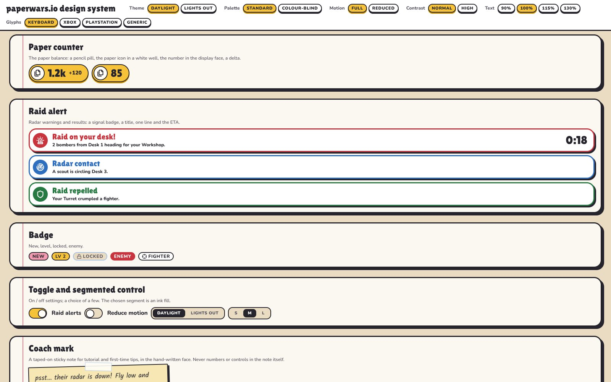

# paperwars.io design system

**Since:** v0.0.15 phase 2 ([plan](roadmap/v0.0.15.md) §1, §2, §6, §8, §9)
**Gallery:** open the game with `?ui-gallery` (for example `http://localhost:5173/?ui-gallery`).
**Inventory it builds on:** [UI_AUDIT.md](UI_AUDIT.md) (phase 1).
**Look:** the developer's own style guide, the paperwars.io design system and screen mockups
(2026-11-06), kept in [docs/style-guide/](style-guide/) as the reference; see section 10.

One set of tokens, one set of components and one focus model for every screen, single-player and
multiplayer. Later phases rebuild each screen on it. A later feature that needs a new component
adds it here and to the gallery; it does not build one ad hoc.



| File | What it holds |
|---|---|
| `src/ui/tokens.ts` | Every token, both themes and both palettes, `applyTokens()`, `colour()` |
| `src/ui/fonts.ts` | The three self-hosted faces (Lilita One, Nunito, Kalam) |
| `src/ui/icons.ts` | The icons: Lucide 0.460.0 nodes (copied by `tools/lucide-icons.mjs`) and the game's own |
| `src/ui/components.ts` | The components (HTML string functions) and `ConfirmDialog` |
| `src/ui/components.css` | Component styles, the focus ring, the focus tooltip, reduced motion. Tokens only |
| `src/input/FocusNav.ts` | The focus manager (`FocusManager`; `FocusNav` is the old name, kept) |
| `src/input/glyphs.ts` | Glyph labels per device, `glyphText()`, `applyGlyphs()`, `DIALOG_KEYS` |
| `src/input/Controls.ts` | Wires keyboard and controller to the focus manager |
| `src/ui/gallery/Gallery.ts` | The `?ui-gallery` page |

---

## 1. Tokens

`src/ui/tokens.ts` is the one source. `applyTokens()` writes every token as a CSS custom property
on `:root` at boot (`src/main.ts`), so every stylesheet and every element reads the same values,
also elements outside `#hud` (the focus tooltip, dialogs, the loading screen).

Since the style guide (section 10) the values are the guide's: its names (`paper-100`, `ink-900`,
`pencil-400`, …) are tokens, and the names from v0.0.7 to v0.0.14 are aliases onto them, so every
rule written before keeps working.

### A. Colour

| Group | Tokens |
|---|---|
| Style guide | `--paper-100`, `--paper-50`, `--desk-200`, `--rule-300`, `--margin-red`, `--ink-900`, `--ink-600`, `--graphite`, `--pencil-400`, `--pencil-600`, `--cardboard-400`, `--cardboard-700`, `--eraser-300`, `--sticky-200`, `--tape-100`, `--sky-500`, `--raid-500`, `--win-500`, `--on-signal`, `--team-1` … `--team-8` |
| Surfaces | `--paper` (= paper-50), `--paper-solid` (= paper-50), `--paper-2` (recessed, = desk-200), `--edge` (= rule-300), `--backdrop` |
| Ink | `--ink` (= ink-900), `--ink-2`, `--ink-3` (= ink-600), `--on-colour` (= on-signal, text on a coloured fill) |
| Meaning | `--friend` (= sky-500), `--hostile` (= raid-500), `--warn`, `--good` (= win-500), `--off`, `--objective` (orange), `--neutral` (grey) |
| Status | `--threat-1` to `--threat-3`, `--tracking`, `--locking`, `--firing`, `--gold`, `--silver`, `--bronze` |
| Focus | `--focus`, `--focus-glow` |
| Tinted chips | `--chip-{good,friend,hostile,warn,gold,streak}-bg` and `-fg` |

Owners follow the art direction: player `--friend` (blue), hostile `--hostile` (red), neutral
`--neutral` (grey), objective `--objective` (orange). `ownerColour(owner)` returns them.

### B. Everything else

| Group | Tokens | Values |
|---|---|---|
| Spacing | `--s1` … `--s8`; the guide's `--space-1` … `--space-12` | 4 px steps: 4, 8, 12, 16, 20, 24, 28, 32 (and 40, 48) |
| Radius | `--r` (= radius-md), `--r-s` (= radius-sm), `--r-pill`; `--radius-sm`, `--radius-md`, `--radius-lg`, `--radius-pill` | 6, 12, 20, 999 px |
| Strokes | `--stroke-hair`, `--stroke-line` (buttons, chips), `--stroke-card` (cards, panels), `--stroke-focus` | 1, 2, 3, 3 px |
| Type: faces | `--font-display` (= `--num`), `--font-body` (= `--font`, `--mono`), `--font-note` | Lilita One, Nunito, Kalam |
| Type: sizes | `--t-xs` … `--t-xl` (HUD scale, as tuned); the guide's `--t-label` 12, `--t-body-sm` 14, `--t-body` 16, `--t-doodle` 18, `--t-title` 24, `--t-counter` 28, `--t-display-l` 40, `--t-display-xl` 64 | all × text scale |
| Shadows (hard, no blur) | `--shadow-press`, `--shadow-card`, `--shadow-lift` (the guide's), `--shadow-hard-sm`, `--shadow-hard`, `--shadow-hard-lg` (marker shadows in graphite) | |
| Elevation | `--elev-flat`, `--elev-raised` (= `--shadow` = shadow-hard), `--elev-floating` (= shadow-hard-lg) | tooltips, alerts and dialogs float |
| Motion | `--dur-fold`, `--dur-pop`, `--dur-fade`, `--dur-slide`, `--dur-tip`, `--dur-press`, `--dur-calm`; `--ease-pop` (spring), `--ease-out`, `--ease-in` | 220, 220, 180, 200, 120, 90, 120 ms |
| Motion, ready to use | `--motion-fold`, `--motion-pop`, `--motion-fade`, `--motion-slide`; `--fast` (old name of the fold) | duration + easing |
| Focus ring | `--focus-width`, `--focus-offset`, `--focus-glow-width` | 3px, 2px, 0 (no glow) |
| Scale | `--ui-scale` (HUD size S / M / L), `--fit-scale` (resolution, set by `HUD.ts`), `--text-scale` | |

### C. Options

`applyTokens(root = document.documentElement, options)` takes:

| Option | Effect |
|---|---|
| `theme: 'daylight' \| 'lightsOut'` | The style guide's two themes (sets `data-theme="daylight" \| "lights-out"` on the root). Every name keeps its meaning; the palette and contrast options apply on top |
| `palette: 'standard' \| 'colourblind'` | Swaps colour values, never names. The colour-blind palette is Okabe–Ito based: blue and vermillion for friend and hostile, bluish green for good, orange for warning, reddish purple for objective and locking; threat levels step in lightness too |
| `highContrast` | Solid card stock, darker `--ink-2`, `--ink-3`, `--edge`, a darker backdrop |
| `reducedMotion` | Every duration becomes 0ms. `:root[data-motion='reduced']` also ends every other animation and transition at once (looping pulses included); panels, dialogs, alerts and coach marks fade in over `--dur-calm` (120ms) instead of springing |
| `textScale` | Multiplies every type size; independent of HUD size |
| `hudScale` | Writes `--ui-scale` (HUD.setScale still sets it on `#hud`, which wins) |

Options not given keep their current value. At boot the player's system preferences
(`prefers-reduced-motion`, `prefers-contrast`) are the defaults; settings arrive in phase 7.
`applyTokens` also sets `data-palette`, `data-contrast` and `data-motion` on the root.

### D. Reading tokens in code

| Helper | Use |
|---|---|
| `colour(name)` | The value in the palette in effect, for canvas `fillStyle` (mini-map, markers) |
| `colourRgb(name)`, `withAlpha(name, a)` | sRGB 0–1 for engine colours; an `rgba()` at a set opacity |
| `cssColour(name)` | `var(--name)`, for inline styles that follow palette swaps |
| `onTokensChange(fn)` | Redraw canvas code after a palette or contrast change |
| `tokenVars(options)`, `tokenCss(options)` | The tokens as a map or a `:root { … }` block (tests, docs) |

Rule: no hex colour in new CSS or TypeScript. Use a token; add one to `tokens.ts` if none fits.

---

## 2. Components

Each component is a function that returns an HTML string, like the rest of the HUD: a module
writes `innerHTML` and updates it in place. Styles are in `components.css`, classes start `ui-`.

| Component | Function | Role and name | Notes |
|---|---|---|---|
| Card | `card({ bodyHtml, title?, icon?, label?, id?, tone?, elevation?, fold?, state? })` | `group`, named by its title | The container for every panel: paper, 3px ink outline, hard shadow; springs in (`fold` kept for the API, no corner since the style guide) |
| Chip / tag | `chip({ label, value?, icon?, tone?, tip?, state? })` | text | Tones: `good`, `friend`, `hostile`, `warn`, `gold`, `streak`, `objective` |
| Button | `button({ label, variant?, icon?, key?, device?, size?, tip?, id?, disabled?, state? })` | `button` | `primary`, `secondary`, `danger`; `key` shows the binding |
| Icon button | `iconButton({ icon, name, tip?, key?, device?, badge?, state? })` | `button`, `aria-label` = name | Tooltip defaults to the name |
| Info button | `infoButton({ name, tip, key?, state? })` | `button` | Opens its tooltip (Y / Triangle) |
| Bar | `bar({ value, label, valueText?, level?, kind?, size?, segments?, state? })` | `meter` | Segmented (10 by default; `segments: 0` plain; thin and mini plain). Level from `format.level`: over 0.6 ok, over 0.3 worn, else critical. Worn and critical are hatched, so colour is never alone |
| Stat | `stat({ icon, value, label, delta?, deltaTone?, suffix?, tone?, state? })` | `group`, named by label | Value and delta come formatted (`format.ts`) |
| Pips | `pips({ filled, total, label, tone?, shape?, state? })` | `img`, named by label | `tone: 'threat'` colours by count |
| Tooltip | `tooltipAttrs(text, id?)`, `tooltip({ id, text, open? })` | `tooltip` | `data-tip` shows on hover, on focus after 450 ms, and by the info button |
| Alert | `alert({ title, value?, icon?, severity?, count? })` | `alert` (critical) or `status` | Severities `info`, `good`, `warning`, `critical`; at most three show |
| List / grid | `list({ label, itemsHtml, layout?, columns?, scroll? })` | `list`, named | `scroll` makes it a page-scrolled list (`data-nav-scroll`) |
| Tabs | `tabs({ id, label, tabs, prev?, next?, device? })`, `tabPanel(...)`, `bindTabs(root, onChange)` | `tablist` / `tab` / `tabpanel`, `aria-selected`, `aria-controls` | Selected is also underlined |
| Dialog | `dialog({ id, title, body?, confirm, cancel, danger?, device? })` | `dialog`, `aria-modal`, labelled and described | Use `ConfirmDialog` to show one |
| Glyph | `glyph({ key, pad?, padText?, literal? }, { device?, literal? })` | text in `<kbd>` | See section 4 |
| Meter | `meter({ label, value, valueText, icon?, kind?, level?, segments? })` | the bar's `meter` | The guide's Meter: label, segmented bar, value as text; low (critical) turns raid and is hatched, progress fills pencil |
| Paper counter | `paperCounter({ value, label, delta?, icon? })` | `status`, named | Pencil pill, the icon in a white well, the number in the display face |
| Raid alert | `raidAlert({ title, body?, eta?, icon?, tone? })` | `alert` (raid) or `status` | Badge, title, a line, the ETA; tones raid, info, win |
| Badge | `badge({ label, kind?, icon?, tip? })` | text | new (eraser), level (pencil), locked (desk), enemy (raid) |
| Toggle | `toggleSwitch({ label, checked, hideLabel?, disabled? })` | `switch` | Pencil when on |
| Segmented | `segmented({ label, items, id? })` | `group`; buttons `aria-pressed` | The chosen one is an ink fill (the pause menu's settings) |
| Coach mark | `coachMark({ text, close, extraHtml?, name? })` | `note` | Sticky note, slight tilt, the hint in Kalam, "Got it". Tips and the tutorial use its look |
| Mission card | `missionCard({ title, icon, typeLabel?, brief?, reward?, risk?, footHtml?, selected?, interactive? })` | `button` (interactive) or article | Notebook page, red margin line, reward in win with trophy and paper, the risk naming the plane in raid |
| Plane card | `planeCard({ name, role, roleIcon?, stats?, cost?, risk?, selected?, footHtml? })` | article, named | Name in the display face, role tag, stat pips, cost in cardboard, "Crash and you lose …" |
| Build slot | `buildSlot({ name, icon?, level?, maxLevel?, status?, meta?, metaIcon? })` | `group`, named | Levels as marks; damaged = raid outline; empty = dashed with a plus |
| Result dialog | `resultDialog({ title, sub?, tone?, rows?, actionsHtml?, bodyHtml? })` | `group`, labelled | Home safe (win) or crumpled (raid) |
| Scoreboard | `scoreboard({ label, columns, rows })` | table, named | Ruled table; your row has a sky edge |
| Team chip | `teamChip({ name, team, desk?, you? })` | text | Team colour with its seat number, never colour alone |
| Caption | `caption({ text, icon?, direction?, directionLabel?, state? })` | `status` | Sound captions: "[Rocket lock]", icon, an arrow toward the source (radians from the nose). `Captions` in `src/ui/Captions.ts` shows them |

### A. States

States are data attributes, so a module sets them like any other attribute and the gallery can
force them.

| State | Markup | Looks |
|---|---|---|
| default | nothing | |
| hover | `data-state="hover"` or real `:hover` | lifts or brightens |
| focused | `data-state="focused"`, `.pad-focus` or `:focus-visible` | the focus ring |
| pressed | `data-state="pressed"` or `:active` | pressed down |
| disabled | `disabled` on controls (`aria-disabled` on others), plus `data-state="disabled"` | faded, grey |
| warning | `data-state="warning"` | amber outline or text |
| critical | `data-state="critical"` | red outline or fill |

### B. Usage rules

- **No literal text in components.** Every word comes in as an argument, from the dictionary
  (`src/ui/strings.ts`). A test renders every component with sentinel arguments and fails if
  any visible text, `aria-label`, `title` or `data-tip` did not come from them.
- Arguments named `…Html` are trusted markup (other components). Every other string is escaped.
- Numbers come formatted (`format.ts`): the components never format.
- Icon plus number; one to three words; colour always with a shape, icon or label.
- Sizes come from tokens and `em`, so components follow the HUD size (zones scale) and the text scale.
- Give controls stable identifying attributes (`data-act`, `data-id`, `data-tab`, …) so the focus
  manager finds them again after a re-render (section 3).
- A screen's main action is `variant: 'primary'` (class `primary`): the focus manager starts there.

### C. Confirm dialog

`new ConfirmDialog(host = document.body)`; `open(options) → Promise<boolean>`; `close(ok)`;
`isOpen`; `element`.

```ts
const sure = await confirmDialog.open({
  title: SAY.endSortieTitle, body: SAY.endSortieBody,
  confirm: { label: SAY.endSortie, key: DIALOG_KEYS.confirm },
  cancel: { label: SAY.keepFlying, key: DIALOG_KEYS.cancel },
  danger: true,
});
```

- Focus moves to confirm, and is trapped (Tab, Shift+Tab, arrows). Closing returns focus.
- Esc cancels; Enter or Space presses the focused button; a backdrop click cancels.
- On a controller, the focus manager confines the highlight to the dialog; A presses, B cancels.
- No key reaches the game while it is open.
- Use it for End sortie, Leave, Remove, Reset and Abandon (phase 4). Keep the keyboard shortcuts.

---

## 3. Focus

One focus manager (`FocusManager` in `src/input/FocusNav.ts`) for the whole UI. `Controls` owns
one (`controls.nav`) on the whole document.

### A. Rules

| Rule | How |
|---|---|
| Directional moves | D-pad, left stick, arrow keys. Nearest control in that direction (straight ahead beats close to the side) |
| Overrides | `data-nav-up`, `-down`, `-left`, `-right` = a selector for the neighbour; `none` blocks the direction |
| Start | `[data-nav-default]`, else the largest `.primary`, else the top-left control |
| Confirm / back | A / Enter presses the highlight; B / Esc goes back (cancels a dialog first) |
| Tabs | Q / E, LB / RB switch the visible tab list (`role="tablist"`). Without tabs the keys keep their game meaning |
| Pages | LT / RT, PageUp / PageDown scroll the list the highlight is in; at the desk only `data-nav-scroll` lists |
| Tooltips | `data-tip` (else `title`) shows near the highlight after 450 ms and closes on move; Y / Triangle in menus shows it at once |
| Restore | A screen opened by re-rendering: going back to a screen restores its control. `openPanel(el)` / `closePanel()` for panels opened by code |
| Modal trap | Only inside `[aria-modal="true"]`. When it closes, the highlight returns to where it was |
| Flight | The HUD is never focusable in flight; entering flight clears the restore history |
| Reachable | Visible, enabled, not `[hidden]`, `[inert]`, `.dev-panel` or `.pad-skip`, and topmost at its centre |
| Candidates | `button`, `a[href]`, `[data-nav]`, `[role="tab"]`, `input`, `textarea`, `select` |

### B. Keyboard and the game

The highlight is a class (`pad-focus`), not browser focus, so Enter and Space keep their game
meanings. The arrow keys are not game keys (checked by a test against `KEYMAP`), so outside flight
they turn the highlight on. Only then do Enter, Q and E serve the highlight; moving the mouse
turns it off again. Text fields take real focus when pressed, and typing never reaches the game.

### C. API

| Member | Use |
|---|---|
| `setActive(on)`, `active` | Show or hide the highlight (Controls does this from the device and context) |
| `update()` | Each frame: keeps the highlight on something reachable, follows dialogs, shows tooltips |
| `move(dir)` | `'up' \| 'down' \| 'left' \| 'right'` |
| `press()`, `back()` | Confirm the highlight; cancel an open dialog |
| `switchTab(±1)`, `page(±1, anyScroller?)`, `info()` | Tabs, pages, tooltip now |
| `reset(screen?)`, `clearHistory()` | A new screen (with restore when going back) |
| `openPanel(el)`, `closePanel(el?)`, `focus(el)` | Explicit restore and placement |
| `bindHoverTips(target)` | Mouse hover shows the same tooltips |
| `focused`, `modalScope`, `tipElement` | Read state (tests) |

Options (tests): `rectOf`, `hitTest`, `tipDelayMs`, `now`.

---

## 4. Glyphs

Every hint shows the binding for the device in use, and switches live.

| Device | Labels |
|---|---|
| Keyboard | the key as written (`Enter`, `Esc`, `Q / E`) |
| Xbox | A, B, X, Y, LB, RB, LT, RT, View, Menu |
| PlayStation | ✕, ○, □, △, L1, R1, L2, R2, Share, Options |
| Generic | as Xbox |

- **Bindings are the source** (`src/input/bindings.ts`): `KEYMAP`, `PAD_PRESS`, `PAD_HOLD` decide what a key
  or button does, and `bind(action, padAction?)` returns the glyph spec to show for it
  (`bind('base')` = `{ key: 'B', pad: 'north' }`), `pair(a, b)` a combined hint ("Q / E" / "LB / RB"),
  `keyFor`, `padButtonFor`. `KEYBOARD_LABELS` and `padControlLabels` (tutorial, dashboard) derive from
  them too, so rebinding (v0.0.19) updates every hint. Write `bind('…')`, never a key.
- Every key in `KEYMAP` has a `KEY_TO_PAD` entry ('' = hidden on a controller: reached with the
  highlight and A); a test checks it.
- `padText` is a controller template ("{lb} / {rb}", "{lstick}", "{dpad}"): the pause menu's
  controller grid is drawn from the bindings this way, for the family in use.
- Tooltips that name a key: `keyTipAttrs(text, spec)` or `tipKey` on `button` / `iconButton`
  ("Base (B)" → "Base (Y)" / "Base (△)", or "Base" without an equivalent).
- Text that names actions: `withKeys('fold it ({fold})')` (tips) puts the binding's glyph inline.
- `literal` (spec or option): the label already names the device's control (from `controlLabel`):
  never relabelled (the tutorial's chips, the dashboard).
- `controls.simulatePad('playstation' | 'xbox' | 'generic' | null)`: show the interface as if that
  controller were in use (screenshots, tests, the console).
- `glyph({ key, pad })` with no device writes the keyboard key. `applyGlyphs` (run by Controls when
  the HUD changes or the device changes) relabels it for the controller in use: `pad` if given,
  else the `KEY_TO_PAD` table. No equivalent: hidden.
- `glyph(spec, { device })` draws for one device and keeps it (`data-glyph-fixed`): the gallery.
- `glyphText(spec, device)`, `glyphDeviceFor(device, family)` for code.
- `DIALOG_KEYS` holds the confirm (Enter / A) and cancel (Esc / B) bindings.

---

## 5. Adding a component

1. Add the function to `src/ui/components.ts`: text only from arguments, states with
   `stateAttrs`, a role and an accessible name.
2. Style it in `src/ui/components.css` with tokens only, every state included.
3. Add it to the gallery (`src/ui/gallery/Gallery.ts`) with `stateTable`, so it shows in every
   state at S, M and L.
4. Add it to `renderAll` in `src/ui/components.test.ts` (the no-literal-text check) and assert its
   role and name.
5. Add a row to the table in section 2.

---

## 6. Tests

DOM tests run in happy-dom and opt in per file with `// @vitest-environment happy-dom`; the rest
stay in node.

| File | Covers |
|---|---|
| `src/ui/tokens.test.ts` | Both palettes complete, legacy values kept, CSS output, reduced motion, text scale, high contrast, `colour()` matches the CSS |
| `src/ui/components.test.ts` | Every component in every state, roles and names, no literal text, escaping, tabs, glyph selection and live switching, `ConfirmDialog` |
| `src/input/focus.test.ts` | Directional moves, overrides, reachability, re-identification, panel and screen restore, modal trap, tabs, pages, tooltips, Controls wiring |
| `src/input/input.test.ts` | `pickInDirection`, stick navigation, hints (v0.0.11) |

---

## 7. The screens on the system (phases 3 and 4)

The flight HUD and the management screens are built from the components; `src/ui/hud.css` only
places them (tokens only; the developer panel and perf readout keep their own colours, marked).

| Rule | Where |
|---|---|
| Alerts: at most three; critical > warning > good / info, newest first within a level. A lesser alert never pushes out a more important one. Critical: `opts.critical`, or bad news with the raid, rocket, lock, launcher or health icon (so multiplayer's server alerts qualify) | `AlertQueue`, `alertLevel` in `src/ui/Alerts.ts`; `hud.alert(…, seconds, { critical })` |
| Combat de-emphasis: `combat` (tracked or attacked) and `combat-hot` (under fire or locked) on the HUD root, from the threat and air views. The economy strip, dashboard, tutorial, tips and info alerts step back (opacity, scale); anything `[data-critical]` (low health, lock, raid alert, boundary) never does | `combatLevel`, `applyCombat` in `src/ui/HUD.ts` |
| Destructive actions ask first: End sortie, Reset progress / Leave classroom (the same menu button), Abandon operation through `guardActions` (the HUD's actions, so single-player and multiplayer get them); Remove building inside `BaseMode.remove()`, so its X shortcut asks too. Shortcuts open the dialog; Enter / A confirms, Esc / B cancels; a held key does not confirm | `src/ui/confirm.ts` (`requestConfirm`, `confirmThen`, `guardActions`), texts in `CONFIRM_TEXT` (`strings.ts`) |
| Costs show what is missing: the price, and a red chip with the shortfall | `priceHtml` in `src/ui/BaseHud.ts` (tray, inspector, repair all, dashboard) |
| Resources: paper first, then `EconomyView.resources` as more rows of the same shape | `resourceRows` in `src/ui/EconomyStrip.ts` |
| Panels opened by code put the highlight on their first sensible control (`data-nav-default`, else `.primary`) and give it back on close: `focusManager()?.openPanel(el)` / `closePanel(el)`. The screen stack (`reset(screen)`) and the panel stack agree: a panel opened or closed since the last screen change decides | Logbook, pause menu, welcome card, base mode, sortie report |
| Logbook tabs are the Tabs component: Q / E (LB / RB) switch them; achievements and transactions have filters | `src/ui/Logbook.ts` |
| Extension points for v0.0.16 (flight maneuvers), empty and hidden until then: `.maneuver-slot` (`data-p="maneuvers"`) beside the boost meter for crease charges, the "fast enough" marker, refusal reasons and prompts; `.pc-extra` on each plane card and `[data-i="tricks"]` in the inspector for trick cards. Fill them with components; no layout change | `PlaneHud.ts`, `Garage.ts` |
| No hover-only information: `data-tip` everywhere (focus, the info button, and hover through `bindHoverTips`, which Controls binds on the page) | |

## 8. Known gaps (later phases)

- `MiniMap.ts` still has its own colours (phase 5 owns it).
- Phase 6 and 7: see section 9.
- The highlight is not browser focus, so screen readers do not follow it yet.
- The mini-map's zoom buttons work with the mouse only (no key binding yet), and its screen-reader
  label is fixed text; the guide asks for one that says where you, the target and the raiders are.

## 9. Responsive layout and accessibility (phases 6 and 7)

| Topic | How |
|---|---|
| Resolution | `layoutFor(width, height, { safeArea })` in `src/ui/layout.ts`, in CSS px: `fit` (zones, × HUD size) is 1.4 at 1920 × 1080 and in proportion above it (2.8 at 4K), 0.9 at least; it follows the shorter of the height and the safe width (16:10 doesn't clip). `overlay` (pause, welcome, logbook, dialogs, lobby, feedback, focus tooltip, world-marker type) is 1 up to 1080p, then in proportion. Written as `--fit-scale`, `--overlay-scale` on `:root` |
| Device pixel ratio, zoom | CSS px only: a 4K screen at 200% lays out like 1080p (sharp: icons are SVG); browser zoom enlarges |
| Ultrawide | "16:9 HUD" (default on): zones anchor to the corners of a centred 16:9 area (`--safe-x`, `--safe-w`) |
| Settings | `AccessSettings` (`src/ui/access.ts`): `palette` (`standard` / `colourblind`), `textScale` (1 / 1.15 / 1.3), `highContrast`, `motion` (`auto` follows prefers-reduced-motion / `full` / `reduced`), `captions` (`auto` = while muted / `on` / `off`), `safeArea`. Pause menu → Accessibility. Saved in SP `settings.access` and MP `paperwars.mp.settings` `access`, normalised field by field. `HUD.setAccess` applies them live through `applyTokens` |
| Reduced motion | Every animation and transition ends at once; the paper delta, damage numbers, pop words, the hit arc, threat notes and emotes become a still fade; the damage vignette goes; the mini-map stops blinking and pulsing |
| Colour never alone | Aircraft markers (shape), mini-map aircraft (dart hostile, round friendly), mini-map defenses (wreck crossed, engaged ringed, ours underlined), fit letters (underlined / plain / outlined / struck), mission stripes (solid / dotted / hatched / dashed), bars (hatched), chips (labels), owner tape (with a shape) |
| Contrast | `src/ui/contrast.test.ts` checks WCAG ratios over the token tables, both palettes, with and without high contrast: 4.5:1 for text, 3:1 for icons and bold pills |
| Captions | `Sounds.onCue` reports every sound (also muted); `Captions` shows spotted, rocket lock (while the tone beeps), rocket launch, hit, bandit, raid incoming, with the way to the source where known. `play(name, { caption: false })` for a use that means something else (the build blip, our own launch). Multiplayer's lock and raid notes carry a keyed `cue` from the server |

## 10. The developer's style guide (2026-11-06)

The look of every screen is the developer's paperwars.io design system and screen mockups, copied
into [docs/style-guide/](style-guide/): the brand book ([design-system/README.md](style-guide/design-system/README.md)),
[tokens.json](style-guide/design-system/tokens.json), the `pw-` component CSS and READMEs
([components/](style-guide/design-system/components/)) and the screens
([screens/](style-guide/screens/): FlightHud, DeskHud, Settings, Multiplayer, Achievements,
Leaderboard, …). The mockups' images are uploads that are not in the repository; the game has its
own 3D world and models.

| Area | What we adopted |
|---|---|
| Look | Neobrutalist paper and marker: flat colour, 2px outlines on buttons and chips, 3px ink outlines and hard 4–6px shadows on cards, panels and dialogs; radius-md cards, radius-lg dialogs and trays, pill counters and chips. No gradients, no glow, no blurred shadows (hard-stop patterns only for meter segments and the colour-never-alone hatching) |
| Themes | Daylight (default) and Lights out, a setting in the pause menu (Game → Theme), saved in SP `settings.access.theme` and MP `paperwars.mp.settings` `access.theme`. Colour-blind and high contrast apply on top of either |
| Fonts | Lilita One (titles, plane names, HUD numbers), Nunito 600 / 800 / 900 (body), Kalam (tips, the tutorial, coach marks only; never numbers or controls) |
| Icons | Lucide 0.460.0 at a 2.5px stroke in `currentColor`; game-specific icons (turret, launcher, plane silhouettes, escort, crumple, damage) kept and drawn to the same weight |
| Buttons | Primary pencil-400 with graphite text and a pencil-600 edge that drops 2px on press; secondary paper; danger raid; labels uppercase (the guide's `label` style) |
| Motion | Panels spring in (~220ms, overshoot); buttons drop 2px; reduced motion: 120ms fades, no bounces or shakes |
| Voice | New labels in the guide's voice, in `STYLE_TEXT` (`src/ui/strings.ts`): "Raid on your desk!", "Mission done", "Home safe" / "Crumpled", "Crash and you lose your Swift", "Got it" |

### A. Layout after the mockups

| Screen | Mockup | What changed |
|---|---|---|
| Flight | FlightHud | Paper counter top left with the objective card under it (each step as a line with its icon, the reward with trophy and paper); raid alert top centre in the guide's RaidAlert shape; pause chip top right (multiplayer: connection, players and session clock chips, then the kill feed); hull and range meters bottom left; speed, altitude, boost bottom centre (maneuver slot kept); weapons and the round mini-map bottom right (rim, N, ticks, the desk you are over, zoom) |
| Desk | DeskHud | A top bar: paper counter, production and storage chips, Base / Logbook / Menu, and Fold / Launch as the primary button top right; mission cards as notebook pages under it; the garage as a tray of plane cards; the home dashboard as a notebook page |
| Base management | DeskHud | The slot inspector is a card on the right (BuildSlot details: level marks, health meter, stats, actions); the build tray a HUD tray of small paper cards; slot markers in the BuildSlot states |
| Pause menu | Settings | A sheet with the red margin line, a big title, two columns (Game, Accessibility) of rows: name, a short description, a segmented choice |
| Logbook | Achievements, Leaderboard | Sheet with the margin line; achievements as cards with a pencil disc (dashed while locked) and a progress bar; tables as the Scoreboard |
| Lobby | Multiplayer | Sheet with the margin line, big title, 3px fields, rooms and desks as outlined cards (the lobby's redesign is v0.0.19) |
| Sortie report | ResultDialog | Home safe / crumpled over a big coloured title, numbers in outlined wells, ruled rows |
| Tips, tutorial | CoachMark | Taped sticky notes in Kalam, "Got it" |

### B. Deviations from the mockups

- The desk keeps the mission cards on the right, so the garage inspector stays bottom left (the
  mockup's right-side inspector is used for base management, where the cards are hidden).
- No building or plane renders, art wells, texture swatches or the classroom floor plan in the
  mini-map: the game shows its 3D world; the mini-map keeps its own drawing (desks, threats, radar),
  restyled with the tokens (desk-200 floor, outlined desks, thick rim, ticks).
- Bottom-centre action tiles (Fire / Drop / Boost / Go home) are not added: the weapons card keeps
  ink and bombs with their keys (bottom right) and the instruments keep speed, altitude and boost.
- HUD type keeps its tuned sizes (`--t-xs` … `--t-xl`) so the zones still fit at 720p; the guide's
  sizes are tokens for the overlays.
- Settings sections are columns on one sheet, not a left navigation: the pause menu holds few settings.

### C. Licences

| Asset | Licence | Where |
|---|---|---|
| Lilita One (Juan Montoreano) | SIL Open Font License 1.1 | `@fontsource/lilita-one` 5.3.0, latin 400 |
| Nunito (Vernon Adams, Cyreal, Jacques Le Bailly) | SIL Open Font License 1.1 | `@fontsource/nunito` 5.3.0, latin 600 / 800 / 900 |
| Kalam (Indian Type Foundry) | SIL Open Font License 1.1 | `@fontsource/kalam` 5.3.0, latin 400 |
| Lucide icons 0.460.0 | ISC (portions MIT, Feather) | nodes copied into `src/ui/icons.ts` with the notice; `lucide` is a dev dependency |

The fonts are bundled by Vite (about 83 kB of woff2; woff fallbacks are emitted but not fetched by
current browsers); nothing is loaded from Google at run time.
