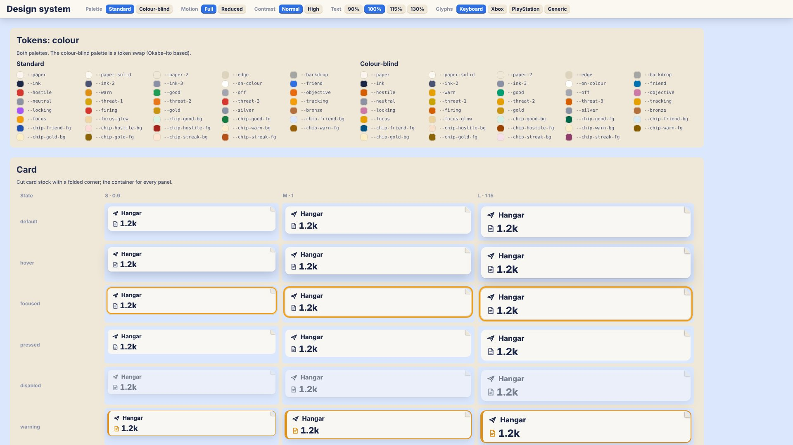

# paperwars.io design system

**Since:** v0.0.15 phase 2 ([plan](roadmap/v0.0.15.md) §1, §2, §6, §8, §9)
**Gallery:** open the game with `?ui-gallery` (for example `http://localhost:5173/?ui-gallery`).
**Inventory it builds on:** [UI_AUDIT.md](UI_AUDIT.md) (phase 1).

One set of tokens, one set of components and one focus model for every screen, single-player and
multiplayer. Later phases rebuild each screen on it. A later feature that needs a new component
adds it here and to the gallery; it does not build one ad hoc.



| File | What it holds |
|---|---|
| `src/ui/tokens.ts` | Every token, both palettes, `applyTokens()`, `colour()` |
| `src/ui/components.ts` | The components (HTML string functions) and `ConfirmDialog` |
| `src/ui/components.css` | Component styles, the focus ring, the focus tooltip, reduced motion. Tokens only |
| `src/input/FocusNav.ts` | The focus manager (`FocusManager`; `FocusNav` is the old name, kept) |
| `src/input/glyphs.ts` | Glyph labels per device, `glyphText()`, `applyGlyphs()`, `DIALOG_KEYS` |
| `src/input/Controls.ts` | Wires keyboard and controller to the focus manager |
| `src/ui/gallery/Gallery.ts` | The `?ui-gallery` page |

---

## 1. Tokens

`src/ui/tokens.ts` is the one source. `applyTokens()` writes every token as a CSS custom property
on `:root` at boot (`src/main.ts`), so every stylesheet and every element reads the same values,
also elements outside `#hud` (the focus tooltip, dialogs, the loading screen).

The names from v0.0.7 to v0.0.14 keep their values, so the existing HUD renders exactly as before.

### A. Colour

| Group | Tokens |
|---|---|
| Surfaces | `--paper` (card stock), `--paper-solid`, `--paper-2` (recessed), `--edge`, `--backdrop` |
| Ink | `--ink`, `--ink-2`, `--ink-3`, `--on-colour` (text on a coloured fill) |
| Meaning | `--friend`, `--hostile`, `--warn`, `--good`, `--off`, `--objective` (orange, new), `--neutral` (grey, new) |
| Status | `--threat-1` to `--threat-3`, `--tracking`, `--locking`, `--firing`, `--gold`, `--silver`, `--bronze` |
| Focus | `--focus`, `--focus-glow` |
| Tinted chips | `--chip-{good,friend,hostile,warn,gold,streak}-bg` and `-fg` |

Owners follow the art direction: player `--friend` (blue), hostile `--hostile` (red), neutral
`--neutral` (grey), objective `--objective` (orange). `ownerColour(owner)` returns them.

### B. Everything else

| Group | Tokens | Values |
|---|---|---|
| Spacing | `--s1` … `--s8` | 4 px steps: 4, 8, 12, 16, 20, 24, 28, 32 |
| Radius | `--r` (card), `--r-s` (small), `--r-pill` | 10px, 7px, 999px |
| Type: faces | `--num` (bold tabular numbers), `--font` (words), `--mono` (key caps) | system faces; no web font yet |
| Type: sizes | `--t-s`, `--t-m`, `--t-l`, display `--t-xl` (= `--t-display`), fine print `--t-xs` | 12, 15, 21, 30, 11 px × text scale |
| Elevation | `--elev-flat`, `--elev-raised` (= `--shadow`), `--elev-floating` (= `--shadow-lift`) | tooltips, alerts and dialogs float |
| Motion | `--dur-fold`, `--dur-pop`, `--dur-fade`, `--dur-slide`, `--dur-tip`; `--ease-pop`, `--ease-out`, `--ease-in` | 160, 220, 180, 200, 120 ms |
| Motion, ready to use | `--motion-fold`, `--motion-pop`, `--motion-fade`, `--motion-slide`; `--fast` (old name of the fold) | duration + easing |
| Focus ring | `--focus-width`, `--focus-offset`, `--focus-glow-width` | 3px, 2px, 6px |
| Scale | `--ui-scale` (HUD size S / M / L), `--fit-scale` (resolution, set by `HUD.ts`), `--text-scale` | |

### C. Options

`applyTokens(root = document.documentElement, options)` takes:

| Option | Effect |
|---|---|
| `palette: 'standard' \| 'colourblind'` | Swaps colour values, never names. The colour-blind palette is Okabe–Ito based: blue and vermillion for friend and hostile, bluish green for good, orange for warning, reddish purple for objective and locking; threat levels step in lightness too |
| `highContrast` | Solid card stock, darker `--ink-2`, `--ink-3`, `--edge`, a darker backdrop |
| `reducedMotion` | Every duration becomes 0ms. `:root[data-motion='reduced']` also ends every other animation and transition at once (looping pulses included) |
| `textScale` | Multiplies every type size; independent of HUD size |
| `hudScale` | Writes `--ui-scale` (HUD.setScale still sets it on `#hud`, which wins) |

Options not given keep their current value. At boot the player's system preferences
(`prefers-reduced-motion`, `prefers-contrast`) are the defaults; settings arrive in phase 7.
`applyTokens` also sets `data-palette`, `data-contrast` and `data-motion` on the root.

### D. Reading tokens in code

| Helper | Use |
|---|---|
| `colour(name)` | The value in the palette in effect, for canvas `fillStyle` (mini-map, markers) |
| `colourRgb(name)`, `withAlpha(name, a)` | sRGB 0–1 for engine colours; an `rgba()` at a set opacity |
| `cssColour(name)` | `var(--name)`, for inline styles that follow palette swaps |
| `onTokensChange(fn)` | Redraw canvas code after a palette or contrast change |
| `tokenVars(options)`, `tokenCss(options)` | The tokens as a map or a `:root { … }` block (tests, docs) |

Rule: no hex colour in new CSS or TypeScript. Use a token; add one to `tokens.ts` if none fits.

---

## 2. Components

Each component is a function that returns an HTML string, like the rest of the HUD: a module
writes `innerHTML` and updates it in place. Styles are in `components.css`, classes start `ui-`.

| Component | Function | Role and name | Notes |
|---|---|---|---|
| Card | `card({ bodyHtml, title?, icon?, label?, id?, tone?, elevation?, fold?, state? })` | `group`, named by its title | The container for every panel; folded corner, folds in |
| Chip / tag | `chip({ label, value?, icon?, tone?, tip?, state? })` | text | Tones: `good`, `friend`, `hostile`, `warn`, `gold`, `streak`, `objective` |
| Button | `button({ label, variant?, icon?, key?, device?, size?, tip?, id?, disabled?, state? })` | `button` | `primary`, `secondary`, `danger`; `key` shows the binding |
| Icon button | `iconButton({ icon, name, tip?, key?, device?, badge?, state? })` | `button`, `aria-label` = name | Tooltip defaults to the name |
| Info button | `infoButton({ name, tip, key?, state? })` | `button` | Opens its tooltip (Y / Triangle) |
| Bar | `bar({ value, label, valueText?, level?, kind?, size?, state? })` | `meter` | Level from `format.level`: over 0.6 ok, over 0.3 worn, else critical. Worn and critical are hatched, so colour is never alone |
| Stat | `stat({ icon, value, label, delta?, deltaTone?, suffix?, tone?, state? })` | `group`, named by label | Value and delta come formatted (`format.ts`) |
| Pips | `pips({ filled, total, label, tone?, shape?, state? })` | `img`, named by label | `tone: 'threat'` colours by count |
| Tooltip | `tooltipAttrs(text, id?)`, `tooltip({ id, text, open? })` | `tooltip` | `data-tip` shows on hover, on focus after 450 ms, and by the info button |
| Alert | `alert({ title, value?, icon?, severity?, count? })` | `alert` (critical) or `status` | Severities `info`, `good`, `warning`, `critical`; at most three show |
| List / grid | `list({ label, itemsHtml, layout?, columns?, scroll? })` | `list`, named | `scroll` makes it a page-scrolled list (`data-nav-scroll`) |
| Tabs | `tabs({ id, label, tabs, prev?, next?, device? })`, `tabPanel(...)`, `bindTabs(root, onChange)` | `tablist` / `tab` / `tabpanel`, `aria-selected`, `aria-controls` | Selected is also underlined |
| Dialog | `dialog({ id, title, body?, confirm, cancel, danger?, device? })` | `dialog`, `aria-modal`, labelled and described | Use `ConfirmDialog` to show one |
| Glyph | `glyph({ key, pad? }, { device? })` | text in `<kbd>` | See section 4 |

### A. States

States are data attributes, so a module sets them like any other attribute and the gallery can
force them.

| State | Markup | Looks |
|---|---|---|
| default | nothing | |
| hover | `data-state="hover"` or real `:hover` | lifts or brightens |
| focused | `data-state="focused"`, `.pad-focus` or `:focus-visible` | the focus ring |
| pressed | `data-state="pressed"` or `:active` | pressed down |
| disabled | `disabled` on controls (`aria-disabled` on others), plus `data-state="disabled"` | faded, grey |
| warning | `data-state="warning"` | amber outline or text |
| critical | `data-state="critical"` | red outline or fill |

### B. Usage rules

- **No literal text in components.** Every word comes in as an argument, from the dictionary
  (`src/ui/strings.ts`). A test renders every component with sentinel arguments and fails if
  any visible text, `aria-label`, `title` or `data-tip` did not come from them.
- Arguments named `…Html` are trusted markup (other components). Every other string is escaped.
- Numbers come formatted (`format.ts`): the components never format.
- Icon plus number; one to three words; colour always with a shape, icon or label.
- Sizes come from tokens and `em`, so components follow the HUD size (zones scale) and the text scale.
- Give controls stable identifying attributes (`data-act`, `data-id`, `data-tab`, …) so the focus
  manager finds them again after a re-render (section 3).
- A screen's main action is `variant: 'primary'` (class `primary`): the focus manager starts there.

### C. Confirm dialog

`new ConfirmDialog(host = document.body)`; `open(options) → Promise<boolean>`; `close(ok)`;
`isOpen`; `element`.

```ts
const sure = await confirmDialog.open({
  title: SAY.endSortieTitle, body: SAY.endSortieBody,
  confirm: { label: SAY.endSortie, key: DIALOG_KEYS.confirm },
  cancel: { label: SAY.keepFlying, key: DIALOG_KEYS.cancel },
  danger: true,
});
```

- Focus moves to confirm, and is trapped (Tab, Shift+Tab, arrows). Closing returns focus.
- Esc cancels; Enter or Space presses the focused button; a backdrop click cancels.
- On a controller, the focus manager confines the highlight to the dialog; A presses, B cancels.
- No key reaches the game while it is open.
- Use it for End sortie, Leave, Remove, Reset and Abandon (phase 4). Keep the keyboard shortcuts.

---

## 3. Focus

One focus manager (`FocusManager` in `src/input/FocusNav.ts`) for the whole UI. `Controls` owns
one (`controls.nav`) on the whole document.

### A. Rules

| Rule | How |
|---|---|
| Directional moves | D-pad, left stick, arrow keys. Nearest control in that direction (straight ahead beats close to the side) |
| Overrides | `data-nav-up`, `-down`, `-left`, `-right` = a selector for the neighbour; `none` blocks the direction |
| Start | `[data-nav-default]`, else the largest `.primary`, else the top-left control |
| Confirm / back | A / Enter presses the highlight; B / Esc goes back (cancels a dialog first) |
| Tabs | Q / E, LB / RB switch the visible tab list (`role="tablist"`). Without tabs the keys keep their game meaning |
| Pages | LT / RT, PageUp / PageDown scroll the list the highlight is in; at the desk only `data-nav-scroll` lists |
| Tooltips | `data-tip` (else `title`) shows near the highlight after 450 ms and closes on move; Y / Triangle in menus shows it at once |
| Restore | A screen opened by re-rendering: going back to a screen restores its control. `openPanel(el)` / `closePanel()` for panels opened by code |
| Modal trap | Only inside `[aria-modal="true"]`. When it closes, the highlight returns to where it was |
| Flight | The HUD is never focusable in flight; entering flight clears the restore history |
| Reachable | Visible, enabled, not `[hidden]`, `[inert]`, `.dev-panel` or `.pad-skip`, and topmost at its centre |
| Candidates | `button`, `a[href]`, `[data-nav]`, `[role="tab"]`, `input`, `textarea`, `select` |

### B. Keyboard and the game

The highlight is a class (`pad-focus`), not browser focus, so Enter and Space keep their game
meanings. The arrow keys are not game keys (checked by a test against `KEYMAP`), so outside flight
they turn the highlight on. Only then do Enter, Q and E serve the highlight; moving the mouse
turns it off again. Text fields take real focus when pressed, and typing never reaches the game.

### C. API

| Member | Use |
|---|---|
| `setActive(on)`, `active` | Show or hide the highlight (Controls does this from the device and context) |
| `update()` | Each frame: keeps the highlight on something reachable, follows dialogs, shows tooltips |
| `move(dir)` | `'up' \| 'down' \| 'left' \| 'right'` |
| `press()`, `back()` | Confirm the highlight; cancel an open dialog |
| `switchTab(±1)`, `page(±1, anyScroller?)`, `info()` | Tabs, pages, tooltip now |
| `reset(screen?)`, `clearHistory()` | A new screen (with restore when going back) |
| `openPanel(el)`, `closePanel(el?)`, `focus(el)` | Explicit restore and placement |
| `bindHoverTips(target)` | Mouse hover shows the same tooltips |
| `focused`, `modalScope`, `tipElement` | Read state (tests) |

Options (tests): `rectOf`, `hitTest`, `tipDelayMs`, `now`.

---

## 4. Glyphs

Every hint shows the binding for the device in use, and switches live.

| Device | Labels |
|---|---|
| Keyboard | the key as written (`Enter`, `Esc`, `Q / E`) |
| Xbox | A, B, X, Y, LB, RB, LT, RT, View, Menu |
| PlayStation | ✕, ○, □, △, L1, R1, L2, R2, Share, Options |
| Generic | as Xbox |

- `glyph({ key, pad })` with no device writes the keyboard key. `applyGlyphs` (run by Controls when
  the HUD changes or the device changes) relabels it for the controller in use: `pad` if given,
  else the `KEY_TO_PAD` table. No equivalent: hidden.
- `glyph(spec, { device })` draws for one device and keeps it (`data-glyph-fixed`): the gallery.
- `glyphText(spec, device)`, `glyphDeviceFor(device, family)` for code.
- `DIALOG_KEYS` holds the confirm (Enter / A) and cancel (Esc / B) bindings.

---

## 5. Adding a component

1. Add the function to `src/ui/components.ts`: text only from arguments, states with
   `stateAttrs`, a role and an accessible name.
2. Style it in `src/ui/components.css` with tokens only, every state included.
3. Add it to the gallery (`src/ui/gallery/Gallery.ts`) with `stateTable`, so it shows in every
   state at S, M and L.
4. Add it to `renderAll` in `src/ui/components.test.ts` (the no-literal-text check) and assert its
   role and name.
5. Add a row to the table in section 2.

---

## 6. Tests

DOM tests run in happy-dom and opt in per file with `// @vitest-environment happy-dom`; the rest
stay in node.

| File | Covers |
|---|---|
| `src/ui/tokens.test.ts` | Both palettes complete, legacy values kept, CSS output, reduced motion, text scale, high contrast, `colour()` matches the CSS |
| `src/ui/components.test.ts` | Every component in every state, roles and names, no literal text, escaping, tabs, glyph selection and live switching, `ConfirmDialog` |
| `src/input/focus.test.ts` | Directional moves, overrides, reachability, re-identification, panel and screen restore, modal trap, tabs, pages, tooltips, Controls wiring |
| `src/input/input.test.ts` | `pickInDirection`, stick navigation, hints (v0.0.11) |

---

## 7. Known gaps (later phases)

- Screens still use the old `hud.css` and `mp.css` rules; phases 3 to 5 rebuild them on the components.
- `MiniMap.ts` and `WorldLabels.ts` still have their own colours; phase 3 reads `colour()`.
- Settings for palette, text scale, contrast and reduced motion arrive in phase 7 (today: system preferences).
- The highlight is not browser focus, so screen readers do not follow it yet.
- No web font is loaded; the faces are system faces until the developer picks fonts (plan §13).
