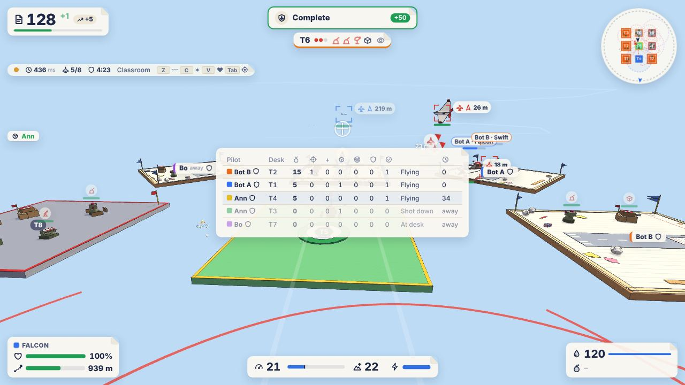

# paperwars.io multiplayer (v0.0.9)

How the shared classroom works: the server, what it decides, what it sends, the rules between
players, how it was tested and measured, and what is still open. The plan this implements is the
v0.0.9 section of the [roadmap](GDD.md#17-development-roadmap).



## Running it

```bash
npm install
npm run server          # the multiplayer server, ws://localhost:2567
npm run dev             # the game; open http://localhost:5173/?mp (or Menu → Multiplayer)
```

Open the address in two windows (or two computers on the same network: `?mp&server=ws://<host>:2567`)
to play each other. Alone, fill the classroom with bots:

```bash
npm run bots -- --count 3                 # three bots join and dogfight
```

```bash
PROTECTION=20 npm run server              # new players can be raided after 20 s (default 5 min)
```

```bash
npm run bots -- --count 1 --raid 1        # a bot that raids other players' bases
```

```bash
LATENCY=150 npm run server                # every server message delayed by 150 ms
```

```bash
npm run loadtest                          # 2, 4, 8 bots, then 8 on a poor network (about 3 min)
```

The server needs Node 20+. It is a plain Node process (`tsx server/index.ts`); `PORT` changes its
port. Sessions live in memory and end when the server stops. Since v0.0.10, players have a
persistent identity (in PostgreSQL with `DATABASE_URL`): see [PERSISTENCE.md](PERSISTENCE.md).

## Architecture

```
 browser (src/mp, ?mp)                            server (server/)
 ─────────────────────                            ────────────────
 Input → numbered 60 Hz frames ──── "in" ──────▶  WorldRoom (Colyseus room, the network edge)
 Predictor (FlightModel, PilotFlight)               │  frames, commands, emotes → ServerWorld
   flies the frames at once                         │  every 1/60 s: ServerWorld.step()
   ◀── "own" (state after frame n) ── reconcile     │  every 50 ms: schema patch + per-player
 PoseBuffer per remote plane ◀── schema patch       │    "own", "me" (private), "ev" (events)
   drawn 100 ms in the past                         ▼
 Mirrors of the rule classes ◀── "me" sections    ServerWorld (no networking; tests drive it)
   GameState, Base (NetBase), Mission               Pilot × 8: GameState, Base, ResourceManager,
   → single-player's HUD (MpViews)                    MissionDirector, PilotFlight, InputClock
 MpHud: lobby, tags, kill feed, scoreboard          shared: DefenseNetwork, AirTraffic, Ordnance,
 Effects, ordnance, bombs ◀── "ev" events             PlayerGuns, FallingBombs, History,
                                                      AttackBook, KillBook
```

**The server decides everything that matters**: where every plane is, every hit and how much it
hurts, every kill, every paper balance, building, mission objective and reward, who owns which
territory and who may raid whom. Clients only send controls (input frames), commands ("fold",
"launch", "build a turret in slot 3", ...) and emotes; there is no message a client could send to
report a hit, a reward or a position.

**The rules are single-player's.** Each player has their own `GameState`, `Base`,
`ResourceManager` and `MissionDirector`, exactly the classes single-player's T1 runs, so folding,
refits, the hangar, ink and bombs, rearming, landing, base building, repairs, mission cards and
their rewards behave as players already know them. The defense network, the ordnance and the AI
pilots are shared by everyone. `ServerWorld` adds only the multiplayer part: whose plane is whose,
who may shoot at whom, raids between players, kills and assists, protections, and what each player
is told.

| Where | What |
|---|---|
| `server/index.ts` | Starts Colyseus (WebSocket transport), the room type and `GET /rooms` for the menu |
| `server/WorldRoom.ts` | The room: joins, claims, drops, reconnects, leaves; fixed 60 Hz steps; schema sync before each patch; per-player messages |
| `server/world/ServerWorld.ts` | The authoritative world: players' flight, guns, bombs, AI traffic, defenses, ordnance, raids, missions, private state |
| `server/world/Pilot.ts` | One player's share: identity, connection, rule objects, flight, input clock, stats, protections, PvP cards |
| `server/world/InputClock.ts` | Input frames and the per-player clock (speed-hack bound, stalls, trimming) |
| `server/world/PlayerGuns.ts`, `History.ts` | Players' ink rounds, lag-compensated against the position history |
| `server/world/FallingBombs.ts` | Bombs (players' and AI bombers') without drawing |
| `server/world/Attacks.ts` | Raid eligibility, rewards, losses, cooldowns, shields; kill and assist credit; bounties |
| `server/world/PvpMissions.ts` | Raid, recon, hunt and interception cards built from ordinary objectives |
| `server/bots/` | Headless bot players (real clients with the browser's prediction) and `npm run bots` |
| `server/loadtest.ts` | The load test |
| `src/net/protocol.ts` | Rates, input frames, commands, private-state sections, events, validation |
| `src/net/schema.ts` | The synchronised world state (Colyseus schema, quantized) |
| `src/net/PilotFlight.ts`, `Prediction.ts`, `Interpolation.ts` | Fixed-step flight shared by server and client; prediction and reconciliation; pose buffers and the server clock |
| `src/net/World.ts` | The shared classroom layout (same on both sides), sides, territory names |
| `src/mp/` | The browser: `MultiplayerGame`, `NetClient`, `Lobby`, `MpHud`, `MpViews`, `NetBase`, `mp.css` |

Single-player is untouched apart from small generalisations it doesn't notice (a player's side
can be `p:<id>`, a territory's threat can change, a base has a side, the defense network accepts
an optional hostility filter, the AI can see several players and keep off several homes, mission
generation can exclude territories, `FlightModel` can save and restore its state). The
multiplayer client is a separate lazily loaded chunk (`?mp`, 250 kB, 81 kB gzipped, mostly the
Colyseus SDK), so single-player's bundle only grows by about 5 kB.

## The network

| | |
|---|---|
| Simulation | 60 Hz fixed steps on the server, and the same steps for the pilot's prediction |
| Input | One frame per step: mouse movement, throttle, bank, boost, auto-level, trigger, bomb; batched per drawn frame, at most 12 per message |
| State | Colyseus schema patches every 50 ms (20 Hz), delta-encoded; positions quantized to 16 bits (about 1 cm), angles to 16 bits |
| Per player, per patch | `own` (their plane's exact state after their last applied frame), `me` (private state sections that changed), `ev` (events) |
| Interpolation | Remote planes drawn 100 ms behind the server's clock, between two known states; up to 250 ms of extrapolation if a patch is late |
| Lag compensation | Players' rounds are tested against other aircraft where the shooter saw them: rewound by half the shooter's round trip (measured by the server) plus the interpolation delay, at most 300 ms |
| Reconnection grace | 60 s |

**Input-driven authority.** The server owes each player one step per 1/60 s of real time and
pays it with the next frame that player sent (`InputClock`). Frames that arrive in a burst wait
and are used one per step owed, so a plane never moves faster than real time allows: a client
that sends frames faster than that (a speed hack, a fast clock) only fills its queue, and a queue
that stays longer than jitter needs is trimmed. A client that goes quiet for more than a second
(a lost connection, a sleeping tab) has its plane flown on by the server, straight ahead with the
guns quiet, until frames come again; frames that then arrive for that time are dropped.

**Prediction and reconciliation.** The pilot's game flies every frame at once through the same
`PilotFlight` (the single-player `FlightModel` plus the airspace boundary and its autopilot) and
keeps it until the server confirms it. With each patch the server sends the plane's complete
flight state (`FlightModel.saveState`: 23 numbers) and the last frame it applied; the game rewinds
to that state and replays the frames the server hasn't seen. The difference from where the plane
was drawn is eased out over a few frames rather than snapped (more than 8 m snaps). The prediction
can't know about damage the server hasn't reported yet (a hit makes a badly damaged plane wobble),
so that is the usual source of small corrections. Frames are clocked from real time, not from the
engine's frame time (which is clamped), so a slow frame never starves the server.

**Events.** Rounds, rockets, bombs, hits, wrecks, kills, emotes, notes and news are batched with
each patch. Everyone's rounds and rockets are drawn from `shot` events and removed by `end`
events; the pilot's own rounds are drawn the moment the trigger is pulled (and not echoed back);
hit markers and damage numbers come from the server's `dmg` events. Private notes (`note`) go to
one player; news (`news`) to everyone.

**What the client may send** is checked (`parseCommand`, `unpackFrames`): unknown or malformed
messages are ignored, mouse movement per frame is clamped, at most 12 frames per message, names
are cleaned and capped at 16 characters, commands are limited to 20 a second, emotes to one every
1.5 s, and a client sending more than 240 messages a second is disconnected by Colyseus. A client
speaking another protocol version is refused at join.

## Sessions (v0.0.13)

There is no permanent world: players meet in **timed sessions**, several at once
([plan](roadmap/v0.0.13.md)). What a player builds and earns is theirs and travels with them
([PERSISTENCE.md](PERSISTENCE.md)); what lives only for a session is its scoreboard, kill streaks,
raids and missions in flight and the AI traffic.

- **A session** is one Colyseus room (`server/WorldRoom.ts`) running one `ServerWorld`, with a
  clock and a capacity (`SESSION` in `src/config.ts`, provisional): 60 minutes, 16 players (one per
  desk), warnings at 10 minutes, 2 minutes and 30 seconds, joining closed 5 minutes before the end,
  closed after 2 minutes with nobody in it. The hour starts when the first player arrives.
- **Opened by the server only.** A room refuses to be created without the process's key
  (`server/sessions/directory.ts`), so a client can neither create a session nor pick its seed,
  length or protection time.
- **The directory** lists the running sessions (`GET /sessions`: players, time left, open or
  closing) and answers quick join (`POST /sessions/quick`): the open session with the most players
  that has space, or a new one. When every session is full or closing a spare opens, so the next
  player finds one waiting; an empty spare stays while others run. The lobby lists sessions with
  players, time left and ping, and the HUD shows the time left.
- **The end.** Raids in progress are settled as they stand, planes in the air go back to their
  hangar in their current condition, missions in flight are called off, every base is packed, and
  everyone gets the **results card** (placing, score, kills, raids, missions, paper earned, players
  who left included) with **Join next session**, which quick joins a new session on a new random
  desk. The connections close 30 s later.
- Sessions are recorded in the database (`sessions`: id, title, capacity, status, times, the
  busiest moment, each player's desk) for restoring and statistics.
- `SESSION_LENGTH=300 npm run server` runs five-minute sessions for trying the end by hand.

## Placement and the territory lifecycle

- **Placement.** Joining puts the player's base on a **random desk open to players**: an open desk
  or one the AI holds (the AI makes way at once), preferring one no plane can see. A "You landed
  on…" card shows the desk on a little map of the classroom. Within the reconnect grace (60 s) a
  player keeps their desk, base and plane; a later join gets a new random desk.
- **Every desk can hold a player** (sixteen of them, T11 included); the AI holds whichever desks
  players don't.
- **The lifecycle** (`TERRITORY_LIFECYCLE`, provisional), shown in the shared state
  (`TerritoryState.state`), the desk labels and the lobby's map:

| State | Meaning | Next |
|---|---|---|
| AI-held | The AI's installations defend it ("Billy's desk"); every desk starts like this | A joining player can be placed here at once |
| Player-held | A player's base is on it | The player leaves or drops → Draining |
| Draining | The player has left or dropped; the base stays with its defenses active, through the reconnect grace and until a raid on it is settled | Back in time → Player-held; otherwise base packed → Empty |
| Empty | Bare ("Empty desk"); nobody can be placed here | After 2 minutes → Open |
| Open | Bare ("Free desk"); a joining player may be placed here | Placed → Player-held; nobody for 5 minutes → AI-held |

- The AI moves in only where no player's plane can see it, and missions never aim at an empty or
  open desk.
- Each player starts with 100 paper and their own production, storage, protected reserve, hangar,
  mission board and base, as in single-player. There are no practice targets in sessions (they
  are single-player only).

## Combat

- Every player can shoot every other player (there are no teams yet). Rounds, damage, destruction
  and the plane's handling as it gets hurt are the server's.
- **Kill credit**: the last player who hurt the plane in the last 15 s gets the kill; everyone
  else who dealt at least 20 % of the recent damage gets an assist. A base's guns credit their
  owner. Crashing into something while recently hurt still credits the attacker, and so does
  **leaving mid-flight**: quitting can't save a lost fight.
- **Bounties**: a kill pays 6 + 40 % of what the plane cost, less for the same victim again within
  5 minutes (100 %, 50 %, 25 %, then nothing), and nothing for a free emergency Dart. An assist pays
  3. These are paid by the game, not taken from the victim.
- **Respawning** is folding a new plane at home, as in single-player (or the free emergency Dart
  when you can't afford one).
- **No spawn camping**: for the first 3 s after take-off other players can't hurt a plane, and AI
  pilots and AI defenses hold their fire at a plane over its own home or just off the runway (as in
  single-player).
- **Who a base's guns shoot**: the AI's aircraft; another player only if that player is raiding
  this base, hurt its owner in the last 45 s, or flies over the territory (platform plus 6 m). A
  base never fires at its owner's plane. The AI's defenses shoot everyone.
- Players see who hit them (damage direction, the "Shot down by …" note and the report) and every
  kill in the kill feed, with weapon and assists.

## Raids between players

A raid is a mission card ("Raid Bo", bombing) against another player's base. It is offered when
the rules allow one, flown like any bombing mission, and scored by the server:

- **Who can be raided** (`AttackBook.refusal`): not yourself; not a player who is offline (nobody
  has to defend while away); not a new player (5 minutes of protection after claiming, which ends
  early if they raid someone themselves); not a base that was raided successfully in the last
  4 minutes (shield); not the same base you raided in the last 10 minutes; not a base someone is
  already raiding; and only one raid at a time per attacker.
- **What it pays**: 55 + 8 per weapon standing on the base, halved if the base has less than 25
  vulnerable paper (not worth farming), and less for repeated raids by the same attacker on the same
  base within 30 minutes (100 %, 50 %, 25 %, then the card isn't offered). Paid by the game.
- **What the defender loses** on a successful raid: a capped share of their **vulnerable** paper,
  the same rule as single-player's AI raids (20 % up to 80 if the store is hit, 10 % up to 40 for
  another building). The protected reserve (50 plus what storage boxes protect) is never touched,
  so a defender can always fold a plane. Buildings hit by the bombs take damage, which stays until
  repaired.
- **The defender** is told at once that a raid has set out ("Bo is coming"), sees the raider on the
  mini-map and gets single-player's raid panel and a banner once their radar (or, without one,
  their lookouts within 45 m) picks it up, and gets a "Stop Bo" interception card on their board.
  Their guns engage the raider. Shooting the raider down counts as a defense, and pays 35 if they
  flew up to do it.
- **Scoring**: a raid's bomb counts when its blast damages the marked structure (or lands within
  reach of it, if it is already wrecked). The raid ends on success, when the attacker is shot down
  or crashes (repelled), or when the mission fails, runs out of time (5 minutes), or the defender
  goes offline (called off). Both sides get a report: outcome, paper lost, structures hit.
- **Outside a raid nobody can damage another player's base** (bombs, rounds and rams do nothing to
  it), so bases can't be ground down by players who aren't raiding.

## Missions

- Each player's board is dealt by their own `MissionDirector` (safe, balanced, risky), adapting to
  their own performance. Missions never send a player to another player's home
  (`MissionContext.excluded`), and practice targets aren't in the shared world, so practice cards
  don't appear.
- Up to two **rival cards** join the board when other players are around: **Raid** (see above),
  **Scout** (fly low over their base for 8 s: 30 paper), **Shoot down** (a rival in the air: 45);
  and **Stop** (intercept the raider coming for your base: 40), which appears while you are being
  raided. They are built from the same objectives as single-player missions, so the tracker,
  markers and rewards work the same.
- A mission's AI aircraft fly in the shared world under their owner's name (`<player>/<id>`), so
  two players' missions never mix; a friendly bomber is on its owner's side. If someone else shoots
  your mission's target down, it still counts for your mission.
- Every objective, failure and reward is decided by the server's `GameState`; the client only shows
  what it is told.

## Players and interaction

- Display names (16 characters, cleaned), a colour per player, name tags with health over other
  players' planes, owner tags on their desks (with a shield while they can't be raided, and a raid
  icon while they are being raided).
- Kill feed with session news (joined, claimed, lost connection, back, left, raids that got
  through), a scoreboard on **Tab** (score, kills, assists, deaths, raids, defenses, missions,
  status, ping) and the connection chip (status, ping, players, protection time left).
- Emotes in flight: **Z** wing waggle, **C** paper confetti, **V** an ink heart over the plane.
- There is no text chat, and no friends, alliances or accounts (by the plan).

Score: kill 10, assist 4, raid that got through 15, raider stopped 10, mission done 5.

## Connections

Nobody escapes a fight by pulling the plug, and nobody is attacked while away (v0.0.13).

| Situation | What happens |
|---|---|
| Connection drops | The SDK reconnects automatically (up to 20 tries); the server keeps the player, their desk and their plane (which flies on straight ahead) for 60 s. Their desk is Draining: no new raid can start on it, but **a raid in progress goes on**, with their defenses firing, and ends as it would have. |
| Back within 60 s | The flight continues where the server kept it; the desk is theirs again. |
| Gone longer, or Leave | The base is packed, unless a raid on it is in progress: then it stays (Draining) until the raid is settled, once, by its id, and only then is it packed and the desk's gap started. A plane still out **in combat** (damage from or to another player in the last 10 s, `PVP.combatWindow`, or on a raid) is **lost as if shot down, and nobody earns a kill for it**; out of combat it **glides home and is returned undamaged**, and its mission fails without further penalty. |
| Just placed | No new raid can target the player for 2 minutes (`PVP.arrivalGrace`), on top of new-player protection, the raid shield, pair cooldowns and the repeat rules. |
| Browser refresh | The reconnection token (session storage) brings the tab straight back; failing that, the device token brings back the same player. |
| Same player twice | The newer connection takes over the seat; the older one is closed with "Opened in another tab" (4011). |
| Session full or ending | A new player is turned away with a message ("This session is full", "This session is about to end"); quick join sends them elsewhere. |
| Session ends | The results card stays up; the connection closes with 4012 and nothing is shown as an error. |
| Server restarts | Everyone is told; raids and missions are settled, planes come home, every base is saved and packed, the connection closes with 4013. After the restart the session is reopened for 5 minutes with every player's desk held for them, and the browser rejoins it by itself ([PERSISTENCE.md](PERSISTENCE.md#v0013-sessions-shutdown-restore-and-crash-recovery)). A plane in the air at a crash comes back in its last saved condition. |

## Hardening and logs

- **Rate limits** (`server/RateLimit.ts`): joins and quick joins per address (a classroom behind
  one address can all join at once, then 60 a minute; this machine is never limited), transfer
  codes per address and per player, and per player commands (20 a second), emotes, usernames.
- **Validation**: join options by type and size; input frames, claims, commands, emotes and
  unknown message types by shape and range. A malformed message is dropped and counted, logged at
  most every 10 s per player; a connection sending nothing but garbage is closed.
- **Clear errors**: the server's refusals are plain sentences (full, ending, ended, restarting,
  protocol version, pass withdrawn, a base saved by a newer build); the transport's are explained
  in the browser ("Can't reach the server…", "That session has closed…").
- **Structured logs** (`server/log.ts`): one JSON line per event with the time, level, session and
  player: `session.open`, `join`, `place`, `leave.held`, `pack`, `mission.settle`, `pvp`, `ledger.refused`,
  `session.warning`, `session.closing`, `session.end`, `session.shutdown`, `session.restore`,
  `join.limited`, `message.malformed` and every error. `LOG_FORMAT=text` prints readable lines.

## Testing

`npm test` runs everything (636 tests with `TEST_DATABASE_URL` set, which adds the PostgreSQL
cases). v0.0.13 added:

- `server/sessions/rules.test.ts`: quick join, spare sessions, closing empty ones, the clock.
- `server/world/wrapup.test.ts` and `server/world/lifecycle.test.ts`: the end of a session,
  placement, every lifecycle state and timer, raids that go on after the defender drops or leaves
  (settled once, the gap starting only afterwards), the arrival grace, the four flight rules, and no
  practice targets.
- `server/sessions.test.ts`, over WebSockets: sessions opened by the server only, quick join and
  the spare, closing empty sessions, joining closing, the end with results and every base packed,
  a departed defender's base held during a raid, graceful shutdown and restore, crash recovery,
  and bots surviving a restart with no base or reward duplicated.
- `server/hardening.test.ts`: rate limits, malformed messages, refused join options, server-only
  settings, structured log lines and readable errors.

Earlier suites:


- `server/world/world.test.ts` drives `ServerWorld` directly: claiming and releasing, the AI's
  defenses swapped and restored, starting economies; flight from frames, the speed-hack bound,
  stalls, reconciliation data; server-decided hits, kills, the kill feed, bounties, spawn
  protection, repeated-kill decay; raid cards, a successful raid (reward, capped loss above the
  reserve, shield, report), offline and new-player protection, base damage outside raids, the
  repeat rule, defense credit; command and frame validation; a server-validated mission reward;
  per-player mission aircraft; drops mid-flight; leaving mid-fight; emotes; the emergency Dart;
  aggression.
- `server/world/prediction.test.ts` plays a predicting client against the server with delayed and
  bunched frames (up to 20 at a time) and checks the prediction never needs correcting.
- `server/room.test.ts` runs the real room over WebSockets: protocol version check, two players
  claiming (and a taken desk refused), the schema and private state each receives, flying from
  frames, a dropped connection resumed with its token, leaving freeing the territory, and the
  ninth player turned away.

## Measurements

`npm run loadtest` (v0.0.13), 20 s per run after everyone has taken off, bots dogfighting with the
browser's prediction, every base saved every 5 s to PostgreSQL (`DATABASE_URL` set), server, bots
and database on one machine (no GPU, shared CPU):

| Players | Sessions | Network | Server step avg / max (ms) | Down per player (KB/s) | Up per player (KB/s) | Corrections / reconciles | Mean correction (m) | Server auto-steps | Frames dropped | Heap (MB) | Drop + resume |
|---|---|---|---|---|---|---|---|---|---|---|---|
| 2 | 1 | local | 0.46 / 2.3 | 7.0 | 1.2 | 0 / 388 | 0.000 | 0 | 0 | 66 | kept seat |
| 8 | 1 | local | 0.65 / 6.6 | 10.1 | 1.2 | 1 / 2300 | 0.042 | 0 | 0 | 75 | kept seat |
| 16 | 1 | local | 0.65 / 7.6 | 12.4 | 1.2 | 2 / 4284 | 0.018 | 0 | 0 | 90 | kept seat |
| 8 | 1 | 120 ± 40 ms, a stall every 5 s | 0.59 / 12.6 | 12.1 | 1.2 | 6 / 2547 | 0.041 | 0 | 0 | 62 | kept seat |
| 16 | 2 (8 each) | local | 0.43 / 3.5 | 9.8 | 1.2 | 0 / 4776 | 0.000 | 0 | 0 | 65 | kept seat |

A full session of sixteen takes about 0.65 ms of each 16.7 ms step, saving included; two sessions
at once share the process without trouble. No errors were logged in any run. The v0.0.9 figures
for up to eight players, in memory:

| Players | Network | Server step avg / max (ms) | Down per player (KB/s) | Up per player (KB/s) | Corrections / reconciles | Mean correction (m) | Server auto-steps | Frames dropped | Heap (MB) | Drop + resume |
|---|---|---|---|---|---|---|---|---|---|---|
| 2 | local | 0.38 / 4.5 | 9.8 | 1.2 | 0 / 1186 | 0.000 | 0 | 0 | 60 | kept seat |
| 4 | local | 0.35 / 3.5 | 10.3 | 1.2 | 0 / 2382 | 0.000 | 0 | 0 | 59 | kept seat |
| 8 | local | 0.43 / 2.4 | 13.3 | 1.2 | 0 / 4758 | 0.000 | 0 | 0 | 54 | kept seat |
| 8 | 120 ± 40 ms, a stall every 5 s | 0.45 / 2.6 | 13.8 | 1.2 | 4 / 4772 | 0.022 | 0 | 0 | 58 | kept seat |

- **Server tick**: a step takes under half a millisecond of its 16.7 ms budget with eight players,
  their bases and the AI (the heap figure includes the bots).
- **Bandwidth**: about 10–14 KB/s down and 1.2 KB/s up per player, most of it rounds and rockets
  in the event stream and the twenty patches a second.
- **Prediction**: no corrections on a good connection; on a poor one (120 ms with ±40 ms jitter
  and a 150–400 ms stall every 5 s, delivered in order as TCP does) 4 corrections in 4,772
  reconciliations, averaging 2 cm.
- **Reconnection**: in every run one bot's connection was cut mid-fight and resumed with its
  token; it kept its seat, desk and plane.
- **In the browser** (headless Chromium, software rendering at about 1 fps on this machine):
  lobby, claiming, folding, launching, flight, remote planes, name tags, the scoreboard, a raid on
  the player by a bot (warning, banner, interception card, loss, shield, report, damaged store in
  base management) and a refresh back into the session all worked, with no page errors and no
  prediction corrections. Frame rate, input feel and combat readability on real hardware still need
  the developer's playtest.

Packet loss on a WebSocket shows up as stalls (TCP resends), which is what the poor-network run
simulates; the load test's bots can be given any latency, jitter and stall rate
(`npm run loadtest -- --latency 200 --jitter 60 --stall 0.5`), and the server can delay everything
it sends (`LATENCY=150 npm run server`) for trying it by hand.

## Known limitations

- **Single server process.** Every session runs in one process (v0.0.14 puts it on the internet);
  matchmaking across servers and regions is v0.0.22. Accounts are v0.0.22.
- **Sixteen desks, sixteen players**: 32-player sessions need the larger classrooms of v0.0.20.
- Remote planes are drawn without their bomb racks or the fold animation on the pad; homes are
  dressed without the Home Desk landmark and tall props, because the server doesn't know their
  collision shapes.
- World events (shipments, convoys, supply runs, AI raids on homes) and operations' world-event
  cards are single-player only; missions that send AI raiders at your home still work.
- Medals, records, streaks, the logbook and the local save aren't used in multiplayer.
- Escorting another player's bomber isn't a mission yet (escort missions with an AI bomber are).
- `npm audit` reports advisories in `@colyseus/auth`'s dependencies (`grant`, `elliptic`), which
  the auth module pulls in although the game doesn't use it.

## Decisions for the developer

1. **The rules in `PVP` (src/config.ts)**: protection and shield times, the raid reward and the
   repeat rule, bounties, aggression time, and the score weights are first guesses for playtesting.
2. **Free-for-all**: everyone is hostile to everyone (no friendly fire question yet). Alliances or
   teams would change the hostility rule in one place (`ServerWorld.hostile`) and the AI's sides.
3. **Raids only through raid cards**: bases can't be damaged outside a raid. Simple and fair, but it
   means a turret shooting at a trespasser can't be shot back unless you are raiding it.
4. **The centre stays the AI's**: or it could become claimable with a special runway.
5. **Hosting**: any Node host with WebSockets works (`PORT`, `npm run server`); the client finds
   the server at the page's host on port 2567, or `?server=wss://…`.
